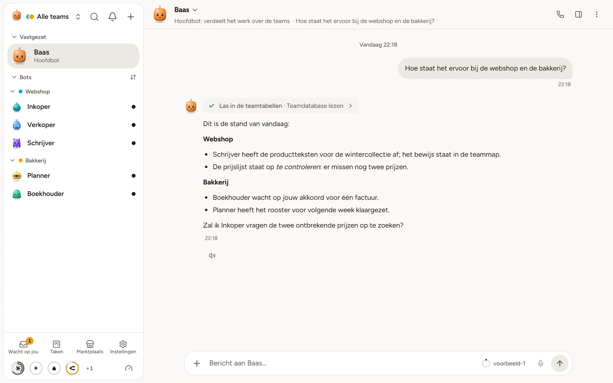
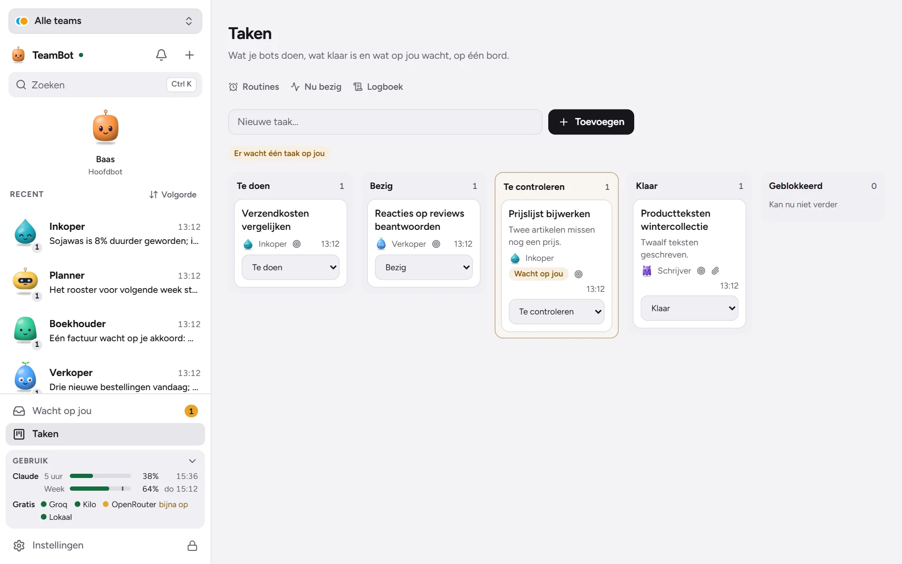
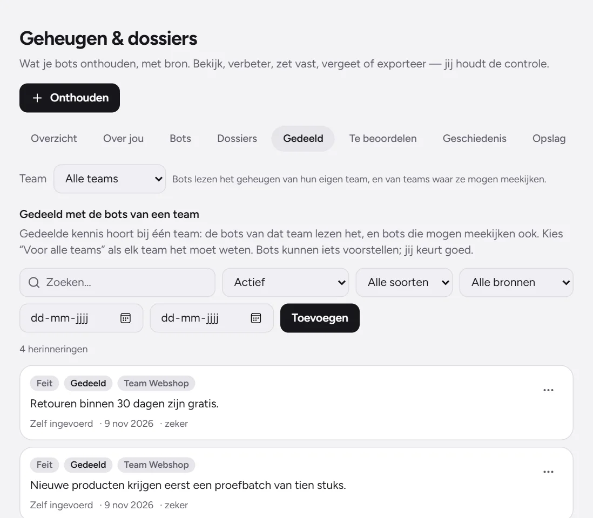
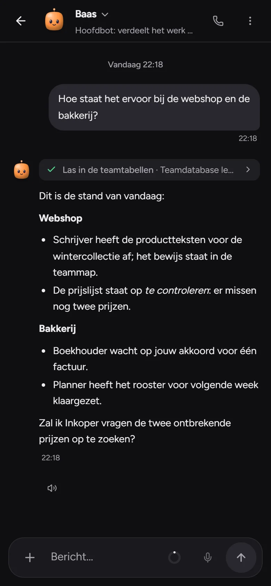
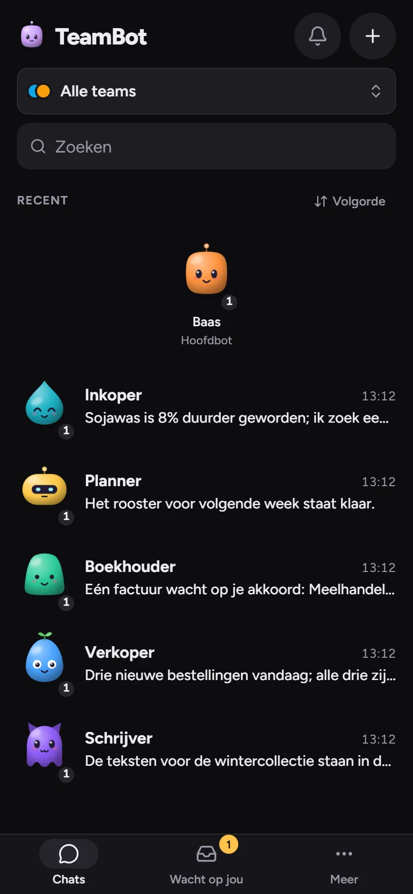

# TeamBot

**Your own team of AI bots, on your own computer.** Free and open source (Apache-2.0). No account.

[**Download for Windows**](https://github.com/milronski-cmd/teambot/releases/latest) ·
[**Download for Mac**](https://github.com/milronski-cmd/teambot/releases/latest) ·
[Website](https://teambot-beta.vercel.app/en/) ·
[Compared with other tools](https://teambot-beta.vercel.app/en/comparison.html) ·
[Nederlands](https://teambot-beta.vercel.app/)



You talk to one main bot. It hands the work to your other bots and shows you what they did. Each bot has its own
role, tools, skills and memory, and works by itself on a schedule. TeamBot uses the AI you already have (Claude Code,
Codex, an API key, Ollama) or free models.

## What it does

| | |
|---|---|
| **Bots** | Each bot has its own name, role, instructions, model, folder, memory and permissions. You make one by describing what it should do. |
| **Teams** | A main bot as the front door, and separate teams with their own folder, memory and budget. Bots hand each other work. |
| **Any model** | More than 20 API providers, local models (Ollama, LM Studio), agent CLIs with your own login (Claude Code, Codex), your own endpoints. When a limit is hit, work moves on to another provider or a free or local model. |
| **Proof** | A task is only "done" after a check with proof. Otherwise it is marked "to check". |
| **Memory** | Memory you can look at: every fact has a source, and you can undo it or really delete it. Bots share memory with their team. |
| **Routines** | Schedules and triggers (webhooks, feeds, folders, e-mail) with history, so bots work without being asked. |
| **Skills and apps** | `SKILL.md` skills and MCP connectors (GitHub, Notion, Linear and more), with a marketplace. |
| **Channels** | Reach your bots through Telegram, WhatsApp, Discord, Slack or e-mail. |
| **Browser and computer** | Each bot has its own browser. You can watch live and take over. |
| **Voice** | Dictate, have answers read aloud, or talk live. |
| **Phone** | Pair your phone with a QR code, get notifications and approve things on the go. |
| **Safe** | Bots ask before they spend money or send important messages to other people. Everything is logged. |

<p>
  
  
</p>
<p>
  
  
</p>

## Install

**Windows 11.** Download `TeamBot-Setup-<version>.exe` from the [latest release](https://github.com/milronski-cmd/teambot/releases/latest)
and run it. The installer is not code-signed yet, so Windows shows a blue window: click **More info**, then
**Run anyway**. When you close the window TeamBot keeps running in the system tray, so routines go on.

**Mac (Apple chip, M1 or newer).** Download `TeamBot-<version>-mac-arm64.dmg`, open it and drag TeamBot to
Applications. This is a test build that is not signed by Apple yet: after the first start, click **Open Anyway** in
System Settings → Privacy & Security.

**Your own server (Docker).**

```bash
git clone https://github.com/milronski-cmd/teambot.git && cd teambot
docker compose up -d
docker compose logs teambot   # the one-time link to create the owner account
```

A fresh server is closed by default: the port is only open on 127.0.0.1 and it can only be set up with that one-time
link. To use it from other devices, put it behind HTTPS (Caddy, Traefik, Cloudflare Tunnel or Tailscale) and set
`TEAMBOT_PUBLIC_URL` to that address.

**Phone.** In TeamBot on your computer, open Settings → Apps and devices → Phone and scan the QR code. The iPhone app
is in testing through TestFlight; on Android you use the browser.

## What it cannot do yet

- No apps in the App Store or Play Store.
- No Linux package. The Mac build has not been used by people on a real Mac yet.
- Your bots stop when your computer is off (unless you run the server).
- The installers are not code-signed.

## Cost and privacy

TeamBot charges nothing. You connect your own AI provider, which bills you directly; local and free models cost
nothing. Chats, files and memory stay on your computer or server. Only what you send to an AI provider or a connection
you chose leaves your device.

## Developing

```bash
npm install
npm run dev:server    # API on http://127.0.0.1:4747 (--mode desktop for a local owner)
npm run dev:ui        # Vite on http://localhost:5173
npm run typecheck && npm test
npm run desktop:dev   # Electron app
npm run dist:win      # Windows installer in release/
```

Architecture and the module contract: [`docs/DEVELOPING.md`](docs/DEVELOPING.md). Security:
[`docs/THREAT_MODEL.md`](docs/THREAT_MODEL.md) and [`SECURITY.md`](SECURITY.md). User manual (Dutch):
[`docs/HANDLEIDING.md`](docs/HANDLEIDING.md). Most of the documentation is still in Dutch.

## Licence

Apache-2.0, see [`LICENSE`](LICENSE) and [`NOTICE`](NOTICE). TeamBot is an independent implementation and contains no
code, texts or trademarks of other agent products.
