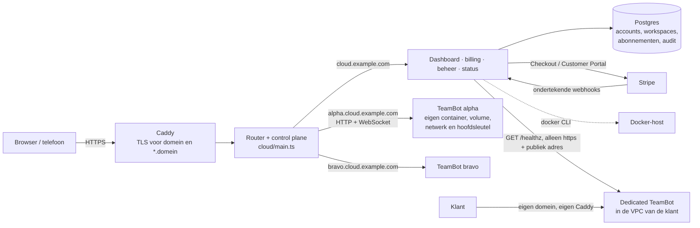

# TeamBot Cloud — beheerde hosting (CLD-04), Dedicated en SLA-rapportage (CLD-05)

TeamBot Cloud is de optionele beheerde versie van TeamBot: klanten krijgen een eigen TeamBot die altijd aan staat, op
`<naam>.<jouw-domein>`, zonder zelf een server te beheren. Het ontwerp staat in
[ADR 0007](adr/0007-beheerde-cloud.md): een **control plane met Postgres** en **één ongewijzigde TeamBot-server
(servermodus) per klant**, achter één router. Het abonnement betaalt alleen de hosting; modelkosten lopen via de eigen
sleutels of CLI-logins van de klant (BYOK, zie [Providerbeleid](PROVIDER_POLICY.md)).

Voor klanten die een eigen server of VPC willen is er **Dedicated** (§8): de klant draait de standaard TeamBot-image
zelf met de [deployment-kit](../deploy/dedicated/README.md); de control plane registreert en bewaakt die instantie,
maar start of proxyt haar niet. Beschikbaarheid, storingen en onderhoud (§9) vormen de meetbasis van de
[concept-SLA](SLA.md); maandrapporten, servicecredits en meldingen staan in §10.

De code staat in `cloud/` en raakt `server/`, `ui/` en `desktop/` niet.

## 1. Architectuur



In woorden: alleen de router is publiek (achter Caddy). Op het hoofddomein serveert hij de control plane; op
`<slug>.<domein>` stuurt hij HTTP en WebSockets door naar precies die ene instantie. Klantdata (gesprekken, geheugen,
sleutels, werkmappen) staat alleen in de instantie; de control-plane-database bevat accounts, workspaces,
abonnementen, facturatie-events, storingen en audit.

| Bestand | Wat |
|---|---|
| `cloud/main.ts` | Start (en `operator <e-mail>`-opdracht) |
| `cloud/server.ts` | Zet database, diensten, control plane en router samen in één HTTP-server |
| `cloud/config.ts` | Alle instellingen uit omgevingsvariabelen (tabel in §6.3) |
| `cloud/db.ts` | Eén query-interface over `pg` (productie) en PGlite (ontwikkeling/tests) + SQL-migraties |
| `cloud/router.ts`, `cloud/proxy.ts` | Host-routering, pauze/404-pagina's, eigenaar-claim, eigen HTTP/WebSocket-proxy |
| `cloud/workspaces.ts` | Levenscyclus: aanmaken, pauzeren, hervatten, exporteren, verwijderen, gezondheid; dedicated registreren |
| `cloud/health.ts` | Adrescontrole en gezondheidscontrole van dedicated instanties (SSRF-bescherming) |
| `cloud/monitoring.ts` | Beschikbaarheid per workspace, automatische storingen, onderhoudsvensters |
| `cloud/reports.ts`, `cloud/alerts.ts` | Maandrapporten en servicecredits; meldingen per e-mail en webhook |
| `cloud/provisioner/` | `process` (ontwikkeling/tests) en `docker` (productie) |
| `cloud/billing/` | Abonnementen (`plans.ts`), Stripe via `fetch` (`stripe.ts`), webhooks + handhaving (`service.ts`) |
| `cloud/accounts.ts`, `cloud/web/` | Accounts/sessies en de server-gerenderde pagina's (zonder JavaScript) |
| `cloud/Dockerfile`, `cloud/docker-compose.cloud.yml`, `cloud/Caddyfile.example` | Productievoorbeeld |
| `deploy/dedicated/` | Deployment-kit voor Dedicated (compose, Caddy, `.env.example`, back-up- en terugzetscript, README) |

## 2. Lokaal draaien

```bash
npm install
npm run cloud:dev            # bouwt de TeamBot-server als dist/ ontbreekt; PGlite + process-provisioner
```

Open <http://cloud.localhost:8080>. `*.localhost` werkt in Chromium, Edge en Firefox zonder DNS-instelling, dus een
workspace staat meteen op `http://<naam>.cloud.localhost:8080`. Gegevens: `.data/cloud/` (PGlite, instanties,
exports, ontwikkelsleutel). Zonder Stripe-sleutels draait de cloud in **handmatig**-modus.

- Beheerder maken: `npm run cloud:operator -- jij@voorbeeld.nl` (account eerst aanmaken via de website; met PGlite
  moet de cloud dan even uit staan, met Postgres kan het altijd). Beheer is bewust niet via de website toe te kennen.
- Tests: `npm run cloud:test` (ook onderdeel van `npm test`).
- Browsercheck (Edge/Chrome, Playwright): `npm run cloud:e2e`, of tegen een draaiende `cloud:dev` met
  `CLOUD_E2E_URL=http://cloud.localhost:8080 npm run cloud:e2e`. Schermafbeeldingen in `<tmp>/teambot-cloud-e2e`.
- Staat je checkout in een map die met een punt begint (zoals `.claude/…`), dan weigert de TeamBot-server zijn
  `index.html` te serveren. Kopieer dan `dist/ui` ergens anders heen en zet `CLOUD_TEAMBOT_UI_DIR` op die map.

De process-provisioner draait instanties als gewone processen op `127.0.0.1` onder je eigen gebruiker. Dat is **geen
isolatie** en alleen bedoeld voor ontwikkeling en tests.

## 3. Zo begint een klant

1. **Account maken** op het hoofddomein (e-mail + wachtwoord, minstens 10 tekens). Met `CLOUD_SMTP_URL` moet het
   e-mailadres eerst bevestigd worden voordat er een workspace gemaakt kan worden.
2. **Workspace maken**: naam + adres (slug). Slugs: kleine letters, cijfers en streepjes, 3–30 tekens, geen `--`,
   geen gereserveerde namen (`www`, `api`, `status`, `admin`, `cloud`, …). Een slug wordt nooit hergebruikt, ook niet
   na verwijderen. De instantie start met een eigen, willekeurige `TEAMBOT_MASTER_KEY` (versleuteld opgeslagen met
   `CLOUD_SECRET_KEY`, gebonden aan de workspace-id).
3. **Eigenaar-account aanmaken** (zie hieronder) en daarna in TeamBot zelf teamleden uitnodigen.

### Eigenaar-account: claim in plaats van een open setup-pagina

Een verse TeamBot-server laat de eerste bezoeker van `/api/public/setup` eigenaar worden. In de cloud zou dat een race
zijn: wie de URL als eerste raadt, neemt de workspace over. Oplossing **zonder wijziging in `server/`**:

- De router blokkeert elke spelling van `/api/public/setup` (hoofdletters, dubbele slashes, `%73`, `..`, …) op
  workspace-hosts, behalve met een geldige claim.
- In het dashboard kiest de eigenaar **Eigenaar-account aanmaken**. De control plane maakt een eenmalig token (30
  minuten geldig, alleen de hash staat in de database) en stuurt de browser naar
  `https://<slug>.<domein>/_cloud/claim?t=…`. De router zet het token in een HttpOnly, SameSite=Strict-cookie op
  alleen die host en stuurt door naar `/`.
- TeamBot toont zijn eigen eerste-start-pagina; de setup-aanvraag gaat alleen door met dat cookie (het cookie zelf
  wordt er door de router afgehaald). Bij succes markeert de control plane de workspace als geclaimd; daarna is de
  setup-route op die host voorgoed dicht.
- Afgewezen alternatief: `TEAMBOT_OWNER_EMAIL/PASSWORD` meegeven. Dan kent de control plane het wachtwoord en staat
  het in de containerconfiguratie (`docker inspect`).

**Tweede laag (gebouwd):** elke instantie krijgt `TEAMBOT_SETUP_TOKEN` (per workspace afgeleid met HMAC uit
`CLOUD_SECRET_KEY`, dus niets extra op te slaan; in Docker alleen via de omgeving, nooit op de opdrachtregel). De
server accepteert `/api/public/setup` alleen met dat token; de router voegt het toe als header bij een geldige claim en
verwijdert een meegestuurde `x-teambot-setup-token` van alle andere verzoeken. Zo hangt de bescherming niet alleen
van de router af.

## 4. Abonnementen, handhaving en BYOK

Abonnementen staan in `cloud/billing/plans.ts` (aan te passen met `CLOUD_PLANS`, JSON): **Proef** (gratis,
`CLOUD_TRIAL_DAYS`, standaard 14), **Starter** en **Team**, elk met mensen, opslag, geheugen, CPU en pids-limiet. Elke
nieuwe workspace begint met de proef; daarna kiest de klant een abonnement.

| Situatie | Gevolg |
|---|---|
| Proef voorbij, geen betaald abonnement | Pauzeren (`trial_ended`): instantie stopt, data blijft |
| Betaling mislukt (`invoice.payment_failed`) | Status *achterstallig*; na `CLOUD_GRACE_DAYS` (7) pauzeren (`payment_failed`) |
| Betaald (`invoice.paid`) of weer actief | Hervatten: zelfde data, zelfde sleutel |
| Opgezegd (`customer.subscription.deleted`) | Pauzeren (`canceled`), export aangeboden, verwijderen na `CLOUD_RETENTION_DAYS` (30) |
| Pauze door beheer (`operator`) | Wordt nooit automatisch opgeheven door billing |

Een periodieke taak (`CLOUD_ENFORCE_INTERVAL_MS`, standaard 5 min) voert dit uit; na elk webhook-event gebeurt het
direct voor die workspace. De beslissing zelf is een pure functie (`decide()` in `billing/service.ts`).

**Modelkosten zitten er niet in.** Dat staat op de prijzen-, dashboard- en workspacepagina. Bots gebruiken de eigen
API-sleutels of CLI-abonnementen van de klant; de bestaande dagbudgetten in TeamBot blijven gelden.

**Handmatig-modus** (geen `STRIPE_SECRET_KEY`): klanten zien dat betalen via de beheerder gaat; in de beheerconsole zet
de beheerder per workspace het abonnement en de status (proef, actief, achterstallig, opgezegd). Dezelfde handhaving
geldt.

## 5. Export en verwijderen

- **Exporteren** (dashboard → Exporteren): een ZIP met een consistente kopie van de database (`VACUUM INTO`, ook
  terwijl de instantie draait), `attachments/`, `workspaces/`, `skills/`, `master.key` en `LEESMIJ.txt` met
  instructies om zelf verder te draaien. Bij Docker zit de datamap als `data.tar` in de ZIP. Een export is
  `CLOUD_EXPORT_DAYS` (7) te downloaden, alleen door de eigenaar (niet door beheer). Niet meegenomen: browserprofielen
  van bots, logs en oude back-ups.
- **Verwijderen** (typ de slug ter bevestiging): een lopend Stripe-abonnement wordt eerst opgezegd (mislukt dat, dan
  wordt er niets verwijderd), daarna stopt de instantie en worden container, volume, netwerk, datamap en exports
  verwijderd. Er blijft een minimale rij over (id, slug, eigenaar, datums, status `deleted`) zonder sleutel of
  instantiegegevens. Alles staat in de audit.

## 6. Productie

### 6.1 Voorwaarden

- Een domein met DNS-records voor `cloud.example.com` **en** `*.cloud.example.com` naar de host.
- Een Linux-host met Docker (aanbevolen: alleen voor TeamBot Cloud), poorten 80/443 open.
- Postgres 14+ (mag in dezelfde compose of beheerd).
- Optioneel Stripe-account en SMTP voor e-mailbevestiging.

### 6.2 Stap voor stap (één host, Docker Compose)

```bash
cp cloud/Caddyfile.example cloud/Caddyfile        # kies TLS-optie A of B in het bestand
cat > cloud/.env <<'EOF'
CLOUD_DOMAIN=cloud.example.com
POSTGRES_PASSWORD=<lang-willekeurig>
CLOUD_SECRET_KEY=<openssl rand -base64 32>
STRIPE_SECRET_KEY=sk_live_...
STRIPE_WEBHOOK_SECRET=whsec_...
STRIPE_PRICE_STARTER=price_...
STRIPE_PRICE_TEAM=price_...
EOF
docker compose -f cloud/docker-compose.cloud.yml --profile build build
docker compose -f cloud/docker-compose.cloud.yml up -d
docker compose -f cloud/docker-compose.cloud.yml exec cloud node dist/cloud/main.js operator jij@example.com
```

**Bewaar `CLOUD_SECRET_KEY` veilig en apart van de database-back-up.** Zonder die sleutel kunnen bestaande
workspaces niet meer starten (hun hoofdsleutel is ermee versleuteld).

TLS: optie A gebruikt Caddy *on-demand TLS*; Caddy vraagt dan per host een certificaat aan, maar alleen nadat de router
op `/_tls/ask` heeft bevestigd dat de host het hoofddomein of een bestaande workspace is (alleen bereikbaar vanaf
`CLOUD_TLS_ASK_FROM`). Optie B is één wildcard-certificaat via DNS-01 (Caddy-build met de module van je DNS-provider);
beter bij veel workspaces vanwege rate limits van Let's Encrypt.

### 6.3 Omgevingsvariabelen

| Variabele | Standaard | Betekenis |
|---|---|---|
| `CLOUD_URL` | `http://cloud.localhost:<poort>` | Publiek adres van de control plane; workspaces worden `<slug>.<host>` |
| `CLOUD_HOST`, `CLOUD_PORT` | `127.0.0.1`, `8080` | Waar de router luistert (in Docker `0.0.0.0`) |
| `CLOUD_DATA` | `.data/cloud` | PGlite (dev), instanties (process), exports |
| `DATABASE_URL` | — | Postgres. Zonder: PGlite (alleen ontwikkeling; niet in de productie-image) |
| `CLOUD_SECRET_KEY` | dev: gegenereerd | 32 bytes base64; **verplicht** met `NODE_ENV=production` |
| `CLOUD_COOKIE_SECURE` | `1` bij https | Secure-cookies met `__Host-`-prefix |
| `CLOUD_TRUST_PROXY` | `loopback` | Van welke peers `X-Forwarded-*` vertrouwd wordt (`loopback` en/of IP's, `none`) |
| `CLOUD_TLS_ASK_FROM` | `loopback` | Wie `/_tls/ask` mag gebruiken (Caddy) |
| `CLOUD_PROVISIONER` | `process` | `docker` in productie |
| `CLOUD_DOCKER_IMAGE` | `teambot:latest` | Image van de instanties; wijzigen = upgrade (§7) |
| `CLOUD_DOCKER_SELF` | — | Containernaam van de cloud zelf (verplicht bij `docker`) |
| `CLOUD_DOCKER_BIN`, `CLOUD_DOCKER_READ_ONLY` | `docker`, `1` | CLI-pad; read-only rootfilesysteem voor instanties |
| `CLOUD_TEAMBOT_ENTRY`, `CLOUD_NODE_BIN`, `CLOUD_TEAMBOT_UI_DIR`, `CLOUD_START_TIMEOUT_MS` | `dist/server/main.js`, huidige node, —, `30000` | Alleen process-provisioner |
| `STRIPE_SECRET_KEY` | — | Zet Stripe aan (anders handmatig-modus) |
| `STRIPE_WEBHOOK_SECRET` | — | `whsec_…` van het webhook-endpoint; zonder geeft `/stripe/webhook` 404 |
| `STRIPE_PRICE_<ABONNEMENT>` | — | Bijv. `STRIPE_PRICE_STARTER=price_…` |
| `STRIPE_TOLERANCE_SEC` | `300` | Toegestane klokafwijking van webhook-handtekeningen |
| `CLOUD_TRIAL_DAYS`, `CLOUD_GRACE_DAYS`, `CLOUD_RETENTION_DAYS`, `CLOUD_EXPORT_DAYS` | `14`, `7`, `30`, `7` | Termijnen |
| `CLOUD_MAX_WORKSPACES` | `3` | Per account |
| `CLOUD_SIGNUP` | `1` | `0` sluit aanmelden |
| `CLOUD_SMTP_URL`, `CLOUD_MAIL_FROM` | — | E-mailbevestiging (verplicht vóór de eerste workspace als SMTP aan staat) |
| `CLOUD_LOGIN_LIMIT`, `CLOUD_LOGIN_IP_LIMIT`, `CLOUD_SIGNUP_LIMIT` | `5`, `30`, `10` | Per e-mail/IP per 15 min; aanmeldingen per IP per uur |
| `CLOUD_HEALTH_INTERVAL_MS`, `CLOUD_ENFORCE_INTERVAL_MS` | `30000`, `300000` | Achtergrondtaken (0 = uit) |
| `CLOUD_PROXY_MAX_BODY_MB` | `256` | Bovengrens voor verzoeken naar instanties (die hebben zelf kleinere limieten) |
| `CLOUD_PLANS`, `CLOUD_TZ` | —, `Europe/Amsterdam` | Abonnementen aanpassen; tijdzone van datums en onderhoudstijden |
| `CLOUD_INCIDENT_AFTER` | `3` | Mislukte controles op rij voordat automatisch een storing opent |
| `CLOUD_MAINTENANCE_NOTICE_HOURS` | `48` | Zoveel uur vooraf aangekondigd onderhoud telt niet mee voor de beschikbaarheid |
| `CLOUD_DEDICATED_TIMEOUT_MS` | `5000` | Time-out van een gezondheidscontrole van een dedicated instantie |
| `CLOUD_DEDICATED_DEV` | — | `1` = ook http en privé-/loopback-adressen voor dedicated en meldingswebhooks (**alleen ontwikkeling/tests**) |
| `CLOUD_ALERT_LIMIT`, `CLOUD_ALERT_TIMEOUT_MS` | `20`, `5000` | Meldingen per uur per account en kanaal; time-out van een webhook |
| `STRIPE_PRICE_DEDICATED` | — | Optioneel: dedicated ook online betalen (standaard op factuur) |

### 6.4 Stripe instellen

1. Maak in Stripe per betaald abonnement een *Product* met een terugkerende *Price*; zet de price-id's in
   `STRIPE_PRICE_STARTER` en `STRIPE_PRICE_TEAM`.
2. Webhook-endpoint: `https://cloud.example.com/stripe/webhook`, met **precies deze events**:
   - `checkout.session.completed`
   - `customer.subscription.updated`
   - `customer.subscription.deleted`
   - `invoice.payment_failed`
   - `invoice.paid`

   (`customer.subscription.created` mag ook; andere events worden genegeerd en gelogd als `ignored`.) Zet het
   signing secret in `STRIPE_WEBHOOK_SECRET`.
3. Customer Portal aanzetten (Settings → Billing → Customer portal): opzeggen, betaalmethode en facturen.
4. Testen zonder echte betalingen: testsleutels (`sk_test_…`) en `stripe listen --forward-to
   https://cloud.example.com/stripe/webhook`.

Webhooks worden geverifieerd met HMAC-SHA256 over `t.payload` (constant-time, venster `STRIPE_TOLERANCE_SEC`), per
event-id maar één keer verwerkt (`billing_events`), en oudere abonnementsupdates dan de laatst verwerkte worden
genegeerd. Btw/facturen: configureer Stripe Tax en factuurinstellingen in Stripe zelf.

### 6.5 De Docker-host afschermen

- **De Docker-socket is root op de host.** Gebruik bij voorkeur een socket-proxy die alleen deze API-aanroepen
  toestaat: `version`, `network create/connect/disconnect/rm`, `volume create/rm`, `container inspect/run/start/
  stop/update/rm`, `exec` en `cp` (archive; voor export). Of draai Docker rootless.
- Elke workspace krijgt een eigen bridge-netwerk; alleen de cloud-container is op al die netwerken aangesloten.
  Instanties kunnen elkaar dus niet bereiken, wel internet (voor AI-providers).
- Blokkeer in de `DOCKER-USER`-iptables-keten verkeer van workspace-netwerken naar de host, naar het
  metadata-adres `169.254.169.254` en naar interne diensten (Postgres staat op een `internal` netwerk zonder
  instanties).
- Instanties draaien als `node`, met `--cap-drop ALL`, `no-new-privileges`, read-only root, tmpfs voor `/tmp` en
  limieten uit het abonnement (`--memory`, `--cpus`, `--pids-limit`). Er worden geen poorten gepubliceerd.

## 7. Beheer en operations

- **Beheerconsole** (`/operator`, menu *Beheer*, alleen voor de rol operator): workspaces met status, gezondheid,
  beschikbaarheid (30 dagen), opslag en abonnement; pauzeren/hervatten; in handmatig-modus abonnement en status zetten;
  dedicated omgevingen registreren (§8); onderhoud aankondigen en annuleren (§9); platformstoringen melden, bijwerken
  en oplossen; lopende storingen per workspace; per workspace een detailpagina (`/operator/workspaces/<id>`); auditlog. Beheer kan **niet** in workspaces kijken: er is geen route die met verhoogde rechten naar een
  instantie doorstuurt, exports zijn alleen voor de eigenaar en control-plane-cookies gaan nooit naar instanties.
- **Statuspagina** `/status` (en `/status.json` voor monitoring): router, aantallen workspaces (werkt / reageert niet /
  wordt klaargezet / gepauzeerd) en apart dedicated omgevingen (bereikbaar / niet bereikbaar), nooit namen; lopende
  platformstoringen, onderhoud dat bezig of gepland is, en de afgelopen 30 dagen (gezondheidscontroles per dag +
  storingen; aangekondigd onderhoud telt niet mee).
- **Upgrades**: bouw en tag een nieuwe image (`teambot:0.3.0`), zet `CLOUD_DOCKER_IMAGE` en herstart de cloud. Bij het
  starten van elke actieve workspace ziet de provisioner dat de container een oudere image heeft, maakt hem opnieuw
  aan op de nieuwe image en houdt het volume (één voor één, rollend). Test een nieuwe versie eerst met een
  test-workspace; TeamBot draait zijn eigen databasemigraties bij het starten.
- **Back-ups**: `pg_dump` van de control-plane-database (dagelijks) **plus** `CLOUD_SECRET_KEY` apart bewaard; de
  Docker-volumes van workspaces (bijv. met een volume-back-uptool of snapshots van de schijf). Elke TeamBot maakt
  daarnaast zelf dagelijks een databaseback-up in zijn eigen volume.
- **Storing afhandelen**: meld hem in de beheerconsole (titel, wat klanten merken, ernst) zodat de statuspagina klopt;
  plaats updates; *Opgelost* sluit hem. Een instantie die niet reageert: kijk met `docker logs tbws-<id>`; pauzeren en
  hervatten start de container opnieuw.
- **Monitoring**: `/healthz` (router, elke host) en `/status.json`.

## 8. Dedicated: eigen server of VPC (CLD-05)

Voor klanten die TeamBot in hun eigen omgeving willen (eigen VPC, eigen beveiligingsregels, data blijft bij hen).

- **Abonnement** `dedicated` (in `plans.ts`, standaard 100 mensen, prijs "Op offerte"). Betalen standaard **op factuur**
  (handmatig-modus voor die workspace); met `STRIPE_PRICE_DEDICATED` kan de klant ook online betalen.
- **Registreren** (beheerconsole → *Dedicated omgeving registreren*): e-mailadres van een bestaand klantaccount, naam,
  korte naam en het **adres** van hun TeamBot. Het adres moet `https://` zijn, zonder pad of inloggegevens, niet onder
  ons eigen domein, en alle DNS-antwoorden moeten publieke adressen zijn (geen `localhost`, `.local`, privé-, link-local-,
  CGNAT- of metadata-adressen; ook niet verpakt als IPv4-in-IPv6). Alleen met `CLOUD_DEDICATED_DEV=1` mag http en een
  lokaal adres (voor ontwikkeling en tests).
- Na registreren toont de console **één keer** de waarden voor de `.env` van de klant: `TEAMBOT_PUBLIC_URL`,
  `TEAMBOT_SETUP_TOKEN` (willekeurig; wij bewaren alleen de hash) en `TEAMBOT_MAX_USERS`. De `TEAMBOT_MASTER_KEY` maakt
  de klant zelf; die krijgen wij nooit. Token kwijt vóór de eerste setup: *Nieuwe setup-token maken* op de detailpagina.
- De klant installeert met [`deploy/dedicated/`](../deploy/dedicated/README.md) (TeamBot + Caddy met automatische
  HTTPS, hardening zoals bij onze containers, back-up- en terugzetscript) en maakt het eigenaar-account aan via
  `https://<adres>/?setup=<token>`.
- **Er draait niets bij ons**: geen container, geen proxy via `<slug>.<domein>` (die host geeft 404 en krijgt geen
  certificaat), geen hoofdsleutel in onze database. *Openen* in het dashboard gaat rechtstreeks naar het adres van de
  klant.
- **Pauzeren** van een dedicated workspace (betaling, beheer) is een **licentie-/supportstatus**, geen uitschakeling: wij
  kunnen hun server niet stoppen en doen dat ook niet. Het dashboard zegt dat eerlijk; tijdens een pauze meten we geen
  beschikbaarheid.
- **Exporteren en verwijderen** zijn de verantwoordelijkheid van de klant (de data staat bij hen). Het dashboard legt
  uit hoe (back-ups in TeamBot, `backup.sh`); *Verwijderen* beëindigt alleen registratie, bewaking en support en laat
  hun server staan.

## 9. Beschikbaarheid, storingen en onderhoud (SLA-meting)

- Elke `CLOUD_HEALTH_INTERVAL_MS` (30 s) controleert de cloud elke actieve workspace één keer: gedeelde workspaces via de
  provisioner, dedicated workspaces van buitenaf met `GET <adres>/healthz` (time-out `CLOUD_DEDICATED_TIMEOUT_MS`,
  doorverwijzingen alleen binnen hetzelfde adres, verbinding met precies het gecontroleerde IP-adres, max. 4 kB
  antwoord, geen cookies of sleutels).
- Resultaten per workspace per dag (`workspace_health_daily`): het dashboard van de eigenaar en de beheerconsole tonen
  de beschikbaarheid over 30 en 90 dagen, een dagbalk en de storingen. De openbare statuspagina toont alleen aantallen;
  het platformcijfer telt alleen gedeelde workspaces (een server van een klant die uitvalt is geen platformstoring).
- Na `CLOUD_INCIDENT_AFTER` (3) mislukte controles op rij opent automatisch een storing **voor die workspace**
  (zichtbaar voor eigenaar en beheer, niet publiek); de eerste geslaagde controle sluit hem met "Weer bereikbaar."
- **Onderhoud aankondigen** (beheerconsole): titel, toelichting, begin en einde (in `CLOUD_TZ`), voor het hele
  platform (statuspagina) of één workspace (alleen in dat dashboard). Maximaal 24 uur, nooit in het verleden
  (downtime kan niet achteraf worden weggepoetst), annuleren kan. Controles tijdens onderhoud dat minstens
  `CLOUD_MAINTENANCE_NOTICE_HOURS` (48) uur vooraf is aangekondigd, tellen niet mee en openen geen storing; korter van
  tevoren aangekondigd onderhoud wordt getoond met "telt mee als uitval".
- De meetregels staan ook in de [concept-SLA](SLA.md) §3.

## 10. Maandrapporten, servicecredits en meldingen

- **Dagen en maanden in `CLOUD_TZ`.** De gezondheidscontroles worden per *lokale* kalenderdag opgeteld (sinds migratie
  `cloud-003`; oudere rijen waren UTC-dagen). Daardoor heeft een maand exacte grenzen, ook rond zomer- en wintertijd:
  een controle om 23:30 lokale tijd op 31 oktober telt voor oktober, een om 00:30 op 1 november voor november.
- **Maandrapport** (`cloud/reports.ts`): na afloop van de maand maakt de achtergrondtaak (`CLOUD_ENFORCE_INTERVAL_MS`)
  versie 1 voor elke workspace die in die maand bestond. Inhoud: periode, abonnement en doel, getelde/geslaagde/
  mislukte controles, beschikbaarheid, niet-getelde controles tijdens aangekondigd onderhoud, geschatte uitval
  (mislukte controles × interval), onderhoudsvensters (geknipt op de maand, met "telt mee"), storingen van die
  workspace en — voor gedeelde workspaces — platformstoringen met begin, einde en duur binnen de maand, resultaat
  (`met`, `not_met`, `no_target`, `no_data`) en de credit.
- **Onveranderlijk**: `sla_reports` heeft een databasetrigger die `UPDATE` en `DELETE` weigert. Beheer kan met een
  reden een nieuwe versie maken (*Nieuwe versie maken* op het rapport); de oude blijft, een openstaande credit van de
  oude versie vervalt, en het kan niet meer als er al een credit is goedgekeurd. Het systeem zelf maakt nooit een
  tweede versie.
- **Bekijken**: de eigenaar ziet zijn rapporten op de workspacepagina (*SLA-rapporten*), als afdrukbare pagina
  (`/workspaces/<id>/reports/<JJJJ-MM>`, afdrukken/pdf via de browser) en als CSV (`…/csv`) en JSON (`…/json`). Beheer:
  `/operator/reports?month=JJJJ-MM` met alle workspaces, een export van de hele maand als CSV
  (`/operator/reports-export`), en per rapport dezelfde downloads. CSV is RFC 4180 en beschermd tegen
  formule-injectie in spreadsheets.
- **Servicecredits**: per abonnement in de configuratie (`slaTarget`, `credits: [{below, pct}]`, `monthlyPriceCents`,
  `currency`; aan te passen met `CLOUD_PLANS`). De standaardwaarden zijn **voorbeelden** (Starter: doel 99,5 en
  `<99,5 → 10%, <99 → 25%, <95 → 50%`; Team: doel 99,9 en `<99,9 → 10%, <99 → 25%, <95 → 50%`; Proef en Dedicated: geen
  doel). Vergelijken gebeurt met gehele getallen (geen afrondingsfouten): een regel geldt bij een beschikbaarheid
  strikt onder de grens; de zwaarste geldende regel wint; alleen als het doel niet is gehaald. Bedrag = maandprijs ×
  percentage.
- Een credit staat eerst op **Wacht op beoordeling**. Alleen beheer kan goedkeuren of (met reden) afwijzen:
  - Stripe-klant: `POST /v1/customers/<klant>/balance_transactions` met een negatief bedrag (tegoed op de volgende
    factuur), idempotent per rapport → *Verrekend via Stripe* met het transactie-id.
  - Handmatige facturatie: *Te verrekenen*; na verrekening op een factuur *Markeer als verrekend*.
- **Meldingen** (`cloud/alerts.ts`, menu *Meldingen*): per account e-mail (alleen als `CLOUD_SMTP_URL` is ingesteld) en/of
  een webhook. De webhook moet `https://` zijn met publieke DNS-antwoorden (zelfde SSRF-bescherming als de
  gezondheidscontrole; pad en query mogen); doorverwijzingen worden niet gevolgd. Bij het instellen wordt één keer
  een geheim getoond (versleuteld opgeslagen); vervangen kan. Gebeurtenissen: `incident.opened`, `incident.resolved`
  (automatische storingen van die workspace), `report.ready` en `test`. Body: JSON `{id, type, created, workspace:{id,
  slug, name}, data}`; headers `X-TeamBot-Event`, `X-TeamBot-Delivery` en `X-TeamBot-Signature: t=<unix>,v1=<hex>` =
  HMAC-SHA256(geheim, `"<t>.<body>"`). Maximaal `CLOUD_ALERT_LIMIT` (20) meldingen per uur per account en kanaal;
  elke poging staat in de tabel `alerts` (verstuurd, mislukt, rate_limited, overgeslagen) en de laatste tien op de
  pagina *Meldingen*. Meldingen houden de gezondheidscontroles nooit op (ze worden op de achtergrond verstuurd).

### Later: een tweede meetpunt

Nu meet alleen de control plane. Een tweede meetpunt (andere locatie/provider) voorkomt dat een netwerkprobleem bij ons
als uitval van de klant telt. Aanpak als het nodig is:

1. Start een tweede proces met dezelfde code in "alleen meten"-rol (nog te bouwen: `CLOUD_ROLE=checker`), met een
   eigen `CLOUD_CHECKER_ID` en een databasegebruiker die alleen `workspaces` mag lezen en in een eigen tabel mag
   schrijven.
2. Laat elk meetpunt per controle-interval zijn resultaat opslaan (bijv. `health_samples (checker_id, workspace_id,
   slot, ok)`), en tel een interval als mislukt als **beide** meetpunten mislukten (of een meerderheid bij drie).
3. Pas het optellen per dag (`workspace_health_daily`) aan om die gecombineerde uitkomst te gebruiken; maandrapporten
   en credits blijven ongewijzigd.
4. Voor dedicated: geef klanten die 443 afschermen ook het IP-adres van het tweede meetpunt.

## 11. Wat er (nog) niet in zit

- **Niet getest op deze machine**: de Docker-provisioner tegen een echte Docker-daemon (alleen argumenten, foutpaden
  en upgrade-logica zijn getest), echte Stripe-betalingen (adapter getest tegen een nep-Stripe, handtekeningen met
  echte HMAC), echte Postgres via `pg` (dezelfde SQL draait in de tests op PGlite), de productie-image en Caddy-config.
- **Aantal mensen per abonnement** wordt afgedwongen via `TEAMBOT_MAX_USERS` (= plekken van het abonnement): de
  instantie weigert nieuwe accounts boven dat aantal, voor uitnodigingen, SSO en SCIM; geblokkeerde accounts tellen
  niet mee. Een gewijzigd abonnement geldt na de volgende herstart van de instantie. **Opslag** wordt gemeten en
  getoond, niet hard begrensd (Docker-volumes hebben geen quotum zonder speciale opslagdriver).
- Eén control-plane-proces: rate limits en de routecache zitten in het geheugen. Meerdere replica's vragen een
  gedeelde limiter (bijv. in Postgres).
- Geen eigen domeinen per klant, geen automatische VM's per klant, geen e-mail bij pauze/opzegging (alleen via Stripe),
  geen 2FA voor cloudaccounts, geen self-service accountverwijdering (workspaces wel).
- Juridische toets van voorwaarden/privacy vóór commerciële verkoop (ADR 0004), en van de [concept-SLA](SLA.md).
- **Dedicated**: de deployment-kit (compose, Caddy, scripts) is niet op een echte server getest (geen Docker op deze
  machine); de scripts zijn alleen syntactisch gecontroleerd. Gezondheidscontroles komen van het IP-adres van de
  control plane; klanten die 443 afschermen moeten dat adres toestaan.
- **Maandrapporten en credits**: niet getest tegen de echte Stripe (alleen een nep-Stripe; het tegoed via
  `balance_transactions` moet met testsleutels worden nagelopen) en niet met een echte SMTP-server (e-mail via een
  nep-verzender in de tests). Het maximum aan niet-getelde onderhoudsuren per maand (SLA §4) wordt niet automatisch
  afgedwongen. Geen pdf-generator (afdrukken naar pdf via de browser). Platformstoringen die beheer handmatig meldt,
  gaan niet als melding naar klanten (alleen de statuspagina).
- De meting gebeurt vanaf één plek (de control plane): valt die uit of haar netwerk, dan worden er geen controles
  geteld (geen valse uitval, maar ook geen meting).
