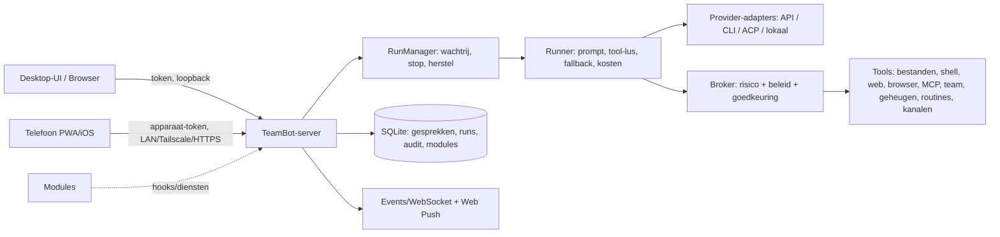

# TeamBot — masterplan (herschreven uitvoeringsplan)

Bron: `docs/ORIGINAL_PLAN.md` (bureaublad-versie van 6 november 2026, §1–26). Dit document is de **leidende,
samengevoegde versie**: het vervangt de losse aanvullingen in het origineel door één geheel. Status per eis staat in de
matrix (§6); de dagelijkse voortgang in `docs/STATUS.md`.

## 1. Doel

Een open-source (Apache-2.0) AI-agentteam-app die de publiek gedocumenteerde functies van OpenBot (nightly-labs),
Grok Bot, OpenMausBot en Bloks evenaart en aantoonbaar beter is op **geheugen, veiligheid, herstel/undo,
installatiegemak, transparantie en kostenbeheersing**. De eigenaar en vrienden gebruiken het gratis; later kan beheerde
cloud-hosting verkocht worden zonder dat de lokale versie iets mist.

**Platformen:** Windows 11 x64-desktop (Electron, installer), self-host/cloud-server (Docker), telefoon-companion (PWA
nu, native iOS-schil zodra Mac + Apple-account er zijn).

## 2. Uitgangspunten

1. **Licentie en hergebruik** — eigen code Apache-2.0; alleen permissieve dependencies (+ MPL-2.0 ongewijzigd, ADR
   0004). Niets kopiëren uit OpenBot (PolyForm Noncommercial), Grok Bot, Bloks, OpenMausBot, OpenClaw, Hermes: eigen
   implementatie op basis van openbare protocollen (MCP, ACP, OpenAI-/Anthropic-API's, Web Push, WebRTC).
2. **Providers** — eigen sleutel, officiële CLI met eigen login of lokaal; nooit doorverkopen of login omzeilen;
   altijd zichtbaar welke route actief is (`docs/PROVIDER_POLICY.md`).
3. **Veiligheid** — deny-by-default voor impact; Broker als enige poort; externe inhoud = data; geen schijn-isolatie
   (`docs/THREAT_MODEL.md`).
4. **Eerlijkheid** — geen knop zonder werkende backend, geen gesimuleerd succes; wat op een platform niet kan wordt zo
   getoond, met wat de gebruiker wél kan doen.
5. **Nederlands eerst**, Engels later (UI-teksten centraal per module).

## 3. Referentievergelijking (samenvatting)

| Capaciteit | Grok Bot | OpenBot | OpenMausBot | Bloks | **TeamBot-keuze** |
|---|---|---|---|---|---|
| Uitvoering | Cloud-computer, altijd aan | Lokaal + self-host | Lokaal + VPS/cloud | Lokaal | Lokaal én self-host; eerlijk "host moet aan staan" |
| Modelkeuze | Automatisch | CLI's + API's + lokaal | CLI/ACP + API + lokaal | Per bot + backup | 20+ API's, CLI's, ACP, lokaal, reserve bij storing (zichtbaar) |
| Geheugen | Automatisch, niet volledig inzichtelijk | Per agent | Zichtbaar, bewerkbaar | Markdown, begrensd, undo | Zichtbaar + bronnen + begrensd + review + undo + hard vergeten |
| Computers | Gedeelde cloud-computer | VM/container/host | Host/VM/cloud/VPS | VM/cloud/host + rehearsal | Eigen browser per bot, host-bediening opt-in, rehearsal/diff/undo, capability-detectie |
| Teams | Groepen, delegatie | Kanalen, delegatie | Rooms, lead, @ | Rooms, lead, hires | Rooms (lead/beurt/iedereen/vermelding), delegatie met limieten, takenbord, menselijke leden |
| Extensies | Apps/MCP/skills | Marketplace | Composio/MCP | Composio/MCP/skills | SKILL.md + MCP + OAuth + marktplaats met scan, pin, rechten-diff |
| Routines | Schema's + events | Routines | Schema's, webhooks, catch-up | Routines, watchers | Schema's + webhooks/feeds/mappen/e-mail, idempotent, limieten |
| Spraak | Voice chat | — | Realtime/TTS | TTS/voice | Dicteren, TTS per bot, OpenAI Realtime, halfduplex voor elke bot |
| Mobiel | iOS/Android | iPhone | iOS | iPhone/Watch | PWA + iOS-schil, QR, beperkte apparaat-tokens, push |

## 4. Architectuur

- **Kern** (`server/core`, `server/agent`, `server/tools`, `server/providers`, `server/api`): auth (eigenaar,
  leden, uitnodigingen, sessies, koppelcodes), versleutelde secrets, audit, persistente runs met herstel na herstart,
  provider-neutrale geschiedenis, per-beurt-context bevroren voor prompt-caching.
- **Modules** (ADR 0006): cli-agents, memory, skills, mcp, routines, rooms, voice, channels, browser, mobile.
- **Vertrouwensgrenzen en dreigingen**: `docs/THREAT_MODEL.md`. **Beslissingen**: `docs/adr/`.
- **Datamodel**: kern-tabellen in `server/core/migrations.ts`; moduletabellen in `docs/modules/<id>.md`.

## 5. UX-kaart

**Desktop (≥1100 px):** zijbalk (start, inbox, bots, recente gesprekken, modulepagina's, instellingen, alles stoppen)
· chat (header met bot/model/toegangsmodus, berichten met tool-kaarten, denkproces, inline goedkeuringen, composer met
bijlagen en module-acties) · zijpaneel (activiteit, bestanden, moduletabs, details). **<1100 px:** zijpaneel als lade;
**<760 px:** zijbalk als overlay — getest op 390 px breed.

**Journeys (acceptatie):**
1. Installeren → privacyuitleg → provider (lokaal automatisch of sleutel) → eerste bot → nuttig antwoord < 3 min.
2. Skill/app → maker/versie/licentie/rechten → bot kiezen → verbinden → read-only test → intrekken.
3. "Onthoud dit" → voorstel met bron → goedkeuren → later geciteerd → ongedaan maken/vergeten.
4. Bot met eigen browser → live meekijken → oefenen op kopie → diff → toepassen/ongedaan maken.
5. Groep → leden/rechten → delegeren → meekijken → actie met impact goedkeuren → logboek.
6. Telefoon koppelen met eenmalige QR → voortgang/goedkeuring onderweg → intrekken → toegang stopt direct.

## 6. Eisenmatrix

Legenda: ✅ gebouwd en getest · 🟡 deels · 🔧 in aanbouw · ⛔ geblokkeerd door externe voorwaarde · ⬜ nog niet.
Prioriteit: P0 fundament, P1 publieke pariteit, P2 geavanceerd/enterprise. "Compleet" = alle P0/P1/P2 ✅ of ⛔ met
werkend alternatief.

### 6.1 Bots (catalogus §21.1)

| ID | Eis | P | Waar | Status | Bewijs |
|---|---|---|---|---|---|
| BOT-01 | Eerste-run setup, provider scannen/koppelen | P0 | shell Home, api/providers | ✅ | screenshot home, autodetect Ollama |
| BOT-02 | Prompt-naar-bot met review vóór opslaan | P0 | /agents/generate, AgentEditor | ✅ | handmatig |
| BOT-03 | Naam/avatar/kleur/rol/instructies/model/denkniveau/toegang/werkmap/tools | P0 | AgentEditor | ✅ | + eigen botgezichten (`ui/src/lib/botface.ts`: 9 vormen, 12 kleuren, ogen/mond/extra, glad/vilt), gezicht-editor, `face:{…}` in `avatar` zonder migratie; `tests/botface.test.ts` (2026-11-07) |
| BOT-04 | Dupliceren, pinnen, archiveren, herstellen, verwijderen met uitleg | P0 | api/agents, AgentEditor | ✅ | — |
| BOT-05 | Export/import profiel (zonder gesprekken/geheugen/secrets) | P0 | agentTemplate | ✅ | core.test |
| BOT-06 | Status/ongelezen/goedkeuringen per bot in zijbalk | P0 | Sidebar | ✅ | bots-first zijbalk (vastgezette tegels, laatste bericht, stemming + tekst, badges); telefoon: lijst → chat; a11y 0, mobile 14/14 (2026-11-07) |
| BOT-07 | Standaardprofielen, sjablonen | P0/P1 | STARTERS + marktplaats | ✅ | 4 starters in de bot-editor, 9 bot-sjablonen en 15 skills in de ingebouwde marktplaats |
| BOT-08 | Reserve-engine bij storing, zichtbaar | P1 | runner fallback | ✅ | geordende reservelijst ≤5, ook voor CLI-engines; limiet onthouden tot reset; per bot overschakelen/wachten/stoppen; zichtbaar in de chat; `tests/cli-tools.test.ts` (2026-11-07) |
| BOT-09 | Kosten/gebruik per bot, dagbudget | P1 | /usage, Settings | ✅ | — |
| BOT-10 | Versiegeschiedenis/diff/undo van profiel | P1 | — | ✅ | tests/agent-versions.test.ts; UI "Geschiedenis" in bot-editor |
| BOT-11 | Rollenbibliotheek, teamsjablonen, hire-voorstel | P1 | skills + rooms | ✅ | rollen via sjablonen, teams met chief of staff, aanname-voorstel met menselijke goedkeuring (tests/rooms.test.ts) |
| BOT-12 | OpenBot-team importeren (één klik, voorbeeld, routines uit) | P0 | openbot-import | ✅ | live tegen de echte OpenBot-data in een tijdelijke map: 10 bots, 34 routines (uit), 4 skills, 255 herinneringen, teammap; 0 van 3.293 OpenBot-bestanden gewijzigd; `tests/openbot-import.test.ts` (2026-11-07) |
| BOT-13 | Gedeelde teammap + extra mappen per bot (lezen/schrijven), ook voor CLI-engines | P0 | folders | ✅ | `tests/folders.test.ts` (2026-11-07) |
| BOT-14 | Toegangsniveau "Volledige toegang" (alleen eigenaar, met waarschuwing; versturen naar anderen en betalen vragen nog) | P0 | broker | ✅ | `tests/full-access.test.ts` (2026-11-07) |

### 6.2 Chat (§21.2)

| ID | Eis | P | Waar | Status | Bewijs |
|---|---|---|---|---|---|
| CHT-01 | Streaming markdown/code/tabellen, tool-voortgang, taakstatus | P0 | runner, ChatView | ✅ | live test OpenAI + screenshot |
| CHT-02 | Stoppen/hervatten, wachtrij/onderbreken per bot | P0 | runs, Composer | ✅ | core.test |
| CHT-03 | Parallelle threads, provider-sessie per thread | P0 | threads | ✅ | — |
| CHT-04 | Bijlagen (plakken/slepen), afbeeldingen | P0 | attachments, Composer | ✅ | — |
| CHT-05 | Antwoorden, doorsturen, bewerken, verwijderen, reacties, pinnen, kopiëren | P0 | api/threads, Message | ✅ | — |
| CHT-06 | Doorzoekbare geschiedenis (FTS5), export MD/JSON | P0 | /search, export | ✅ | — |
| CHT-07 | Lege/laad/fout/offline-staten, tokens/kosten per bericht | P0 | shell | ✅ | — |
| CHT-08 | Contextcompactie | P0 | history.ts + memory-episodes | ✅ | tests/compaction.test.ts; auto na runs + knop "Gesprek samenvatten" |
| CHT-09 | Lokale meldingen, inbox voor vragen/goedkeuringen | P0/P1 | App, Inbox | ✅ | — |
| CHT-10 | Branch/rewind met bestandswijzigingen | P1 | fork.ts + browser (rehearsal/snapshots) | ✅ | vertakken vanaf elk bericht (test), werkmap-snapshots/rehearsal met diff en terugzetten |
| CHT-11 | Formulieren/kaarten, HTML-preview in sandbox | P1 | — | ✅ | ask_form + show_html (afgeschermde iframe met eigen CSP); live getest |
| CHT-12 | Mobiele push, concepten offline | P1 | mobile | ✅ | mobile: Web Push (RFC 8291), concepten "nog niet afgeleverd" |
| CHT-13 | Wachtrij en bijsturen tijdens een beurt (bewerken, volgorde, verwijderen) | P1 | queue | ✅ | `server/agent/queue.ts` + `QueueBar`; API-engines nemen het mee in de beurt, CLI-engines worden onderbroken; `tests/chat-queue.test.ts` (2026-11-07) |

### 6.3 Groepen en teams (§21.3)

| ID | Eis | P | Waar | Status |
|---|---|---|---|---|
| TEAM-01 | Groep maken/hernoemen/archiveren, instructies, gedeelde transcript | P0 | ✅ — rooms-module + UI (hoofdsessie); live: twee OpenAI-bots in lead-modus |
| TEAM-02 | @bot, @iedereen, reply, modi lead/beurt/iedereen/vermelding | P0 | ✅ — 4 werkwijzen, @naam/@iedereen/reply (tests) |
| TEAM-03 | Broadcast parallel, delegatie buiten groep, handoff, status terug | P0 | ✅ — delegate_task, broadcast, handoff; + asynchroon `ask_bot`: vrager wordt met het antwoord gewekt, gebundeld, grenzen per uur/paar/diepte/budget ("Grenzen"), intrekken; `tests/bot-mailbox.test.ts`, `npm run team:live` 13/13 (2026-11-07) |
| TEAM-04 | Stop/hervat één bot of hele groep, time-outs, kostenledger | P0 | ✅ — stop/hervat per bot en groep, time-outs, kostenledger (UI-tab Kosten) |
| TEAM-05 | Lussen/diepte/beurten begrensd, goedkeuring alleen door mens | P0 | ✅ — beurten/diepte/handoffs/cyclus begrensd; goedkeuring alleen door de eigenaar-mens |
| TEAM-06 | Afdelingen, chief of staff, takenbord, menselijke leden/gasten, ACL | P1 | ✅ — teams, takenbord, menselijke leden/gasten met ACL, groepsbestanden; kanaal gekoppeld aan groep werkt (integratietest) |
| TEAM-07 | Team-admin, SSO/SCIM, beleid, quota per team | P2 | sso-module | ✅ — ledenbeleid (budget, max bots, terminal), budget per lid + gebruik per persoon (PRV-06), inloggen met OpenID Connect (PKCE, state, nonce, domein-allowlist, SSO verplicht voor leden met wachtwoord-noodtoegang voor de eigenaar) en SCIM 2.0 (Users: aanmaken, zoeken, wijzigen, deactiveren met direct intrekken van sessies); `tests/sso-scim.test.ts` tegen een lokale nep-IdP. SCIM-groepen (Entra- en Okta-stijl PATCH/PUT) met koppeling per groep naar rol, TeamBot-groepen en dagbudget; terugdraaien alleen van wat de koppeling zelf gaf (`tests/scim-groups.test.ts`). Niet getest tegen echte Entra/Google/Okta |

### 6.4 Providers (§21.4)

| ID | Eis | P | Waar | Status | Bewijs |
|---|---|---|---|---|---|
| PRV-01 | Provider-interface, 20 API-providers incl. OpenAI, Anthropic, Gemini, xAI, OpenRouter | P0 | providers/kinds | ✅ | OpenAI live, mock-tests |
| PRV-02 | OpenAI-compatibel eigen endpoint, Ollama, LM Studio | P0 | kinds | ✅ | autodetect Ollama |
| PRV-03 | Claude Code / Codex / Gemini CLI / OpenCode / ACP-runner | P0/P1 | cli-agents | ✅ — Claude Code, Codex, OpenCode en ACP-agents krijgen alle TeamBot-tools via een MCP-server per run (named pipe, token per run, dezelfde broker en goedkeuringen, connectors via TeamBot); `npm run cli-tools:live` 13/13 per engine, $0 extra (2026-11-07); ADR 0009 |
| PRV-04 | Capability-beschrijving, sleutelopslag, test zonder betaalde prompt | P0 | providers | ✅ | /providers/:id/test |
| PRV-05 | Reserve bij storing, budget | P1 | runner | ✅ | zie BOT-08; standaard Claude Code → Codex → OpenCode gratis (big-pickle) → Ollama → API-sleutels (2026-11-07) |
| PRV-06 | Provider-vloot/admin, routeringsbeleid, org-kluis | P2 | gedeelde providers (org-kluis: leden gebruiken de sleutel zonder hem te zien) + eigen prijzen per model + beleid per gedeelde provider (toegestane modellen, daglimiet per persoon; afgedwongen bij opslaan én bij elke run, ook reserve-provider) + persoonlijk dagbudget per lid en gebruiksoverzicht per persoon (`server/api/provider-policy.ts`, `tests/provider-policy.test.ts`) | ✅ |

### 6.5 Geheugen en dossiers (§13, §21.5)

| ID | Eis | P | Status |
|---|---|---|---|
| MEM-01 | Scopes (over jou/bot/project/gedeeld/episode), bronnen, review, auto-leren aan/uit | P0 | ✅ — memory-module, 25 tests incl. 11 evaluaties (vergeten: 0 restanten) |
| MEM-02 | Lezen/bewerken/pinnen/vergeten/undo, conflicten, dedup, quota, export/verwijderen | P0 | ✅ — memory-module, 25 tests incl. 11 evaluaties (vergeten: 0 restanten) |
| MEM-03 | Dossiers (personen, organisaties, events, besluiten, acties, tijdlijn) | P1 | ✅ — memory-module, 25 tests incl. 11 evaluaties (vergeten: 0 restanten) |
| MEM-04 | Import uit andere assistent, consolidatie, tombstones bij herstel | P1 | ✅ — import/consolidatie; vergeten overleeft back-up-terugzetten (tests/backup-forget.test.ts) |
| MEM-05 | Evaluaties: recall, vergeten, conflict, ACL, quota, vergiftigde invoer | P0 | ✅ — memory-module, 25 tests incl. 11 evaluaties (vergeten: 0 restanten) |

### 6.6 Skills, apps en marktplaats (§21.6)

| ID | Eis | P | Status |
|---|---|---|---|
| EXT-01 | SKILL.md importeren/bekijken/bewerken/versies/verwijderen, per bot | P0 | ✅ — skills-module (import map/zip/URL/standaardmappen, versies, per bot) |
| EXT-02 | Prompt-only vs scripts gescheiden, scan, checksum, rechten-diff bij update | P0 | ✅ — scan op injectie/exfiltratie/secrets/scripts, vertrouwen vereist voor scripts, rechten-diff bij update |
| EXT-03 | MCP stdio/HTTP/SSE, OAuth, scopes, test, intrekken, per-tool risico | P0 | ✅ — mcp-module, 10 tests; live Context7/filesystem/memory |
| EXT-04 | Marktplaats bots/skills/apps, preview, verified/unverified, melden, terugdraaien | P1 | ✅ — internetmarktplaats: skills uit 13 GitHub-collecties + skills.sh (653 live), apps uit het officiële MCP Registry; licentie afgedwongen, cache/offline, takedown; `npm run market:live` 23/23 (2026-11-07) |
| EXT-05 | Connectorcatalogus (GitHub, Notion, Linear, Slack, Google, …) | P1 | ✅ — 15 connectorsjablonen met bron/licentie/teststatus (nagekeken 2026-11-06) |
| EXT-06 | Developer-SDK, uitgever-identiteit, org-allowlist | P2 | ✅ — `packages/teambot-sdk` + `npm run pack:package` (keygen/init/validate/sign/verify/zip), Ed25519-handtekening over canonieke manifest met sha256 per bestand, compatibiliteitsbereik; status ondertekend/vertrouwd/onbekend/niet ondertekend/ongeldig overal zichtbaar; updates door een andere sleutel alleen met bevestiging; beleid open/alleen ondertekend/allowlist server-side afgedwongen voor skills, bot-sjablonen en connectoren (`tests/publisher-sdk.test.ts`, `docs/SDK.md`) |

### 6.7 Computers, browser, bestanden (§14, §21.7)

| ID | Eis | P | Status |
|---|---|---|---|
| CMP-01 | Werkmapgrenzen, shell standaard uit | P0 | ✅ (core.test) |
| CMP-02 | Eigen browser per bot, SSRF/domeinbeleid, login-overdracht | P0 | ✅ — browser-module, 10 tests; live: bot opende example.com in eigen Edge en las h1; schermafbeelding door het model beschreven |
| CMP-03 | Live preview, stoppen/overnemen, actielog, resource-limieten | P0 | ✅ — browser-module, 10 tests; live: bot opende example.com in eigen Edge en las h1; schermafbeelding door het model beschreven |
| CMP-04 | Rehearsal/snapshots/diff/undo | P0 | ✅ — browser-module, 10 tests; live: bot opende example.com in eigen Edge en las h1; schermafbeelding door het model beschreven |
| CMP-05 | Windows host-bediening (opt-in), gedeelde computer met lease | P1 | 🟡 — volledige-scherm computer use voor vision-modellen (`desktop_computer`, multi-monitor/DPI) met niveaus per actie / per taak / volledige toegang; harde blokkades (TeamBot, UAC, wachtwoordmanagers, bank/betalen, wachtwoordvelden); versturen/betalen/verwijderen vragen altijd; rand-indicator, noodstop Ctrl+Alt+Esc, pauze bij muisbeweging, neem over, live beeld, stappenlog; `tests/computer-use.test.ts` (2026-11-07). ⛔ live muistest `npm run desktop:live` nog te draaien wanneer niemand de pc gebruikt |
| CMP-06 | Privé-VM/container | P1 | ⛔ deze pc (Windows 11 Home: geen Hyper-V/Docker) — capability-detectie |
| CMP-07 | Cloud-VM/VPS-backend, GPU-computer | P1/P2 | 🟡 — eigen server/VPS via SSH ✅ (`tests/remote-computer.test.ts`); cloud-VM via Hetzner Cloud ✅ gebouwd: TeamBot maakt de VM met cloud-init, genereert zelf de serversleutel (vooraf vastgezet, geen vertrouwen-bij-eerste-gebruik), aparte gebruiker zonder sudo, metadata-dienst afgeschermd, kostenschatting uit de API en expliciete bevestiging, aan/uit/verwijderen, nooit stil verwijderen, leden standaard uit (`tests/cloud-vm.test.ts` tegen een nep-API); tweede provider DigitalOcean incl. GPU-droplets als aparte groep met waarschuwing over prijs, regio en accountgoedkeuring (`tests/cloud-vm-do.test.ts`). ⛔ echte test met een Hetzner- of DigitalOcean-token |

### 6.8 Routines en triggers (§21.8)

| ID | Eis | P | Status |
|---|---|---|---|
| RTN-01 | Eenmalig/interval/cron met tijdzone, pauze, test, historie, gemiste runs, retry, limieten | P0 | ✅ — tijdzones, pauze, test, historie, gemiste runs, retry, limieten; + maandelijks (dag, laatste dag, eerste/laatste werkdag, n-de weekdag, maanden), in de hoofdchat, wachten op limiet-reset, resultaat naar kanaal (met pdf, ook fouten), ketens ≤5; `tests/routines-parity.test.ts` (2026-11-07) |
| RTN-02 | Idempotent (geen dubbele run), stil pad zonder melding | P0 | ✅ — routines-module, 25 tests (zomertijd, dubbele runs, handtekeningen, replay) |
| RTN-03 | Webhooks (GitHub/Slack/Linear/Sentry-handtekeningen), feeds, pagina- en mapwatchers, e-mail | P1 | ✅ — routines-module, 25 tests (zomertijd, dubbele runs, handtekeningen, replay) |

### 6.9 Spraak (§21.9)

| ID | Eis | P | Status |
|---|---|---|---|
| VOX-01 | Push-to-talk/dicteren met transcript bewerken | P0 | ✅ — lokaal en gratis: sherpa-onnx (Apache-2.0) met Parakeet TDT v3 (CC-BY-4.0) of Whisper turbo (MIT); 10 s spraak in 0,48 s; tekst 61–70 ms na "Klaar" in het invoerveld; Ctrl+Spatie; ook vanaf de telefoon; `npm run voice:live` 16/16 (2026-11-07) |
| VOX-02 | TTS per bot, spraakmemo's, kostenmelding | P0 | ✅ — lokaal: Piper (MIT, los programma) met Nederlandse stemmen Alex (CC0) en MLS (CC-BY-4.0), eerste geluid 53 ms; OpenAI blijft optie (2026-11-07). Sinds 2026-11-08 lokale stemmen voor 10 van de 11 app-talen (ook Portugees, Pools en Turks, permissieve licenties, vastgezet); Arabisch via de systeemstem. Vóór verkoop juridisch laten bekijken: Piper gebruikt espeak-ng (GPL-3.0) als apart proces |
| VOX-03 | OpenAI Realtime via WebRTC met kortlevend secret; spraakbediening van bestaande bot | P1 | ✅ — client-secret 120 s, ask_agent → echte bot; live (< $0,05) |
| VOX-04 | Halfduplex bellen met elke bot, groepsgesprek | P1 | ✅ — bellen met elke bot en groepsgesprek; + gratis live gesprek: spraakdetectie → lokale STT → engine van de bot (ook CLI) → lokale TTS, onderbreken door te praten, werk aan bots geven (2026-11-07) |
| VOX-05 | Vergadernotities met toestemming | P1 | ✅ — pagina Vergadernotities: toestemming, opname-indicator, transcript per 45 s, audio niet bewaard, notulen door gekozen bot; live getest met nep-microfoon (WAV) |

### 6.10 Telefoon en toegang op afstand (§21.10)

| ID | Eis | P | Status |
|---|---|---|---|
| MOB-01 | QR-koppeling eenmalig, apparaatlijst, intrekken (REST + WS) | P0 | ✅ — mobile-module, 10 tests; intrekken sluit WebSocket direct (4401) |
| MOB-02 | Mobiel-beperkte rechten (geen secrets/admin) | P0 | ✅ — default-deny route-allowlist in de auth-laag; spraak/previews toegevoegd |
| MOB-03 | PWA installeerbaar, push, offline-concepten | P0/P1 | ✅ — service worker zonder API-caching, manifest/iconen, eigen Web Push |
| MOB-04 | Native iOS-app (SwiftUI-schil) | P0 | ⛔ Mac + Apple-account — SwiftUI-broncode + macOS-workflow aanwezig, nooit gecompileerd |
| MOB-05 | Android/iPad-optimalisatie | P2 | ✅ — deeldoel (Android-deelmenu → bot/gesprek met bijlagen, alleen op het apparaat tot Versturen), snelkoppelingen, toetsenbord verkleint de pagina, veilige marges, vaste zijbalk vanaf iPad staand, Cmd+K; `npm run mobile:check` 14/14 (Pixel 7, iPad Pro 11 staand/liggend). Op echte toestellen nog niet getest |

### 6.11 Kanalen (aanvulling eigenaar: bereikbaar via chat-apps)

| ID | Eis | P | Status |
|---|---|---|---|
| CHN-01 | Telegram, Discord, Slack, e-mail, WhatsApp Cloud, webhook in/uit | P1 | ✅ — Telegram, Discord, Slack, e-mail, WhatsApp Cloud, webhooks; + WhatsApp via QR (whatsapp-web.js, Apache-2.0; LGPL/GPL-afhankelijkheden vervangen), "Bericht aan jezelf", `@Naam`, spraakmemo/foto/bestand; `channel_send` met bestanden op alle kanalen; `tests/whatsapp-web.test.ts` (2026-11-07). ⛔ koppeltest met de telefoon van de eigenaar (`npm run whatsapp:live`) |
| CHN-02 | Allowlist/koppelcode, antwoorden alleen in hetzelfde gesprek, nieuwe ontvanger = goedkeuring | P0 | ✅ — allowlist/koppelcode, externe afzenders zonder tools, channel_send = danger |

### 6.12 Cloud, team-SaaS, beheer (§21.11)

| ID | Eis | P | Status | Bewijs |
|---|---|---|---|---|
| CLD-01 | Lokaal zonder account | P0 | ✅ | desktopmodus |
| CLD-02 | Docker self-host, multi-user, uitnodigingen, rollen | P0 | 🟡 | servermodus + uitnodigingen + ledenbeleid (eigen map, geen terminal, budgetplafond, geen privé-URL's; tests/member-policy.test.ts) ✅; Docker-image alleen in CI te bouwen (geen Docker op deze pc) |
| CLD-03 | Export/verwijderen/back-up/herstel | P0 | ✅ | back-ups dagelijks + handmatig + terugzetten met veiligheidskopie (tests/backups.test.ts) |
| CLD-04 | Beheerde cloud: Postgres, tenant-isolatie, billing, status | P1 | 🟡 | `cloud/` (ADR 0007): control plane met Postgres (PGlite in tests), één ongewijzigde TeamBot per workspace (process/Docker), router voor HTTP+WebSocket, eigenaar-claim met eenmalige link + `TEAMBOT_SETUP_TOKEN`, plekken via `TEAMBOT_MAX_USERS`, Stripe (Checkout/Portal/webhooks met handtekening), pauzeren bij wanbetaling, export/verwijderen, operatorconsole, statuspagina zonder namen; `tests/cloud.test.ts` (17) + `npm run cloud:e2e`. ⛔ productie: domein + wildcard-TLS, Docker-host, Postgres, Stripe-account (`docs/CLOUD.md`) |
| CLD-05 | Dedicated/VPC, SSO/SCIM, SLA | P2 | 🟡 | dedicated-plan: klant draait TeamBot in de eigen VPC met `deploy/dedicated/` (compose + Caddy-TLS + back-up/hersteltest), control plane registreert het adres, eenmalig setup-token, gezondheidscontrole met SSRF-bescherming, uptime per dag (30/90 dagen), automatische storingen, onderhoudsvensters (≥48 u vooraf telt niet mee); SSO/SCIM via TEAM-07; `docs/SLA.md` als CONCEPT; maandrapport per workspace (Europe/Amsterdam, onveranderlijk, CSV/JSON/print), servicecredits volgens een instelbare tabel die pas na goedkeuring van de operator worden verrekend (Stripe-saldo of handmatig), meldingen per e-mail/ondertekende webhook; `tests/cloud-dedicated.test.ts` (9), `tests/cloud-reports.test.ts` (10). ⛔ juridische toetsing SLA, echte Docker/HTTPS/Stripe/SMTP-omgeving |

### 6.13 Ontwerp en toegankelijkheid (§21.12)

| ID | Eis | Status |
|---|---|---|
| UX-01 | Licht/donker/systeem, tokens, 360 px, toetsenbord (Ctrl+K), focus-stijlen | ✅ — nieuw ontwerp: monochroom donker/licht, Figtree (OFL, lokaal), bots als figuren, oranje app-icoon (`npm run icons`); a11y 0 bevindingen, i18n 0 restanten (2026-11-07) |
| UX-02 | Nederlands; Engels | ✅ NL; EN bèta — woordenboek uit de broncode (`npm run i18n:extract`), automatisch vertaald (`i18n:translate`), toegepast op de gerenderde UI zonder chatinhoud; `npm run i18n:check` controleert alle pagina's. Dynamische teksten van externe diensten blijven in hun eigen taal |
| UX-03 | WCAG 2.2 AA-audit, schermlezer, 200%-schaal | 🟡 — `npm run a11y` (axe-core, WCAG 2.0–2.2 A/AA + reflow-controle) 0 bevindingen op alle pagina's, licht/donker, 1360/640/390/320 px (640 = 200% zoom, 320 = 400% zoom, WCAG 1.4.4/1.4.10); handmatige schermlezertest (NVDA/Verteller/VoiceOver) ⬜ |

### 6.14 Bouw, beveiliging, release (§21.13)

| ID | Eis | Status | Bewijs |
|---|---|---|---|
| REL-01 | CI (Windows + Linux), typecheck, tests, build, licentiecheck | 🟡 | CI met typecheck, tests, build, licentiecheck en E2E-UI-test (Edge); draait zodra de repo op GitHub staat. Lokaal: npm test + npm run e2e groen |
| REL-02 | Windows-installer (NSIS) + checksums + SBOM + notices | ✅ | `release/TeamBot-Setup-0.1.0.exe` gebouwd en verpakte app getest |
| REL-03 | Code signing + auto-update | 🟡 updater ✅ (`desktop/updater.ts`; lokaal end-to-end getest: 0.1.0 → 0.1.1 via eigen updatekanaal, stil geïnstalleerd en herstart); ⛔ codesigning-certificaat (daarna `win.publisherName` voor handtekeningcontrole) |
| REL-04 | iOS TestFlight/App Store | ⛔ Mac + Apple-account |
| REL-05 | Build-provenance/attestatie | 🟡 | release-workflow maakt SLSA-provenance + SBOM-attestatie (GitHub/Sigstore); actief zodra de repo op GitHub staat. Verifiëren: `gh attestation verify TeamBot-Setup-<v>.exe -R <owner>/teambot` |
| SEC-01 | Dreigingsmodel, SECURITY.md | ✅ |
| SEC-02 | Onafhankelijke beveiligingsreview van de hele codebase | ✅ 2026-11-06: 1 kritiek (bot van een ander laten draaien), hoog/midden/laag (SSRF-varianten, bijlage-XSS, rechten in groepen, exfiltratie via afbeeldingen, ledenbeleid-omwegen, telefoonroutes) allemaal opgelost; regressietests in `security-review.test.ts`, `web-safety.test.ts`, `mobile.test.ts`, `member-policy.test.ts` |
| SEC-07 | Masterkey in OS-kluis (Windows DPAPI; macOS Keychain; Linux secret service) | 🟡 Windows ✅ (migratie, harde afsluiting, beschadigde sleutel, herstart met dezelfde sleutel getest); macOS/Linux gebouwd via Electron safeStorage met dezelfde nooit-buitensluiten-logica (`desktop/keystore.ts`, `tests/keystore.test.ts`), Linux zonder libsecret/KWallet houdt bewust het 0600-bestand; ⛔ niet op een Mac/Linux-desktop getest |

## 7. Hergebruik-manifest (productie-dependencies)

Volledige lijst met versies en licenties: `npm run notices` → `THIRD_PARTY_NOTICES.txt` + `sbom.cdx.json`
(181 pakketten, allemaal permissief: MIT/Apache/BSD/ISC e.d.). Belangrijkste: express (MIT), ws (MIT),
@anthropic-ai/sdk (MIT), @modelcontextprotocol/sdk (MIT), playwright-core (Apache-2.0), croner (MIT), discord.js
(Apache-2.0), imapflow (MIT), nodemailer (MIT-0), qrcode (MIT), zod (MIT), yaml (ISC), turndown
(MIT), adm-zip (MIT); UI: react (MIT), zustand (MIT), react-markdown (MIT), lucide-react (ISC), tailwindcss (MIT).

## 8. Volgorde en afhankelijkheden

1. Kern + app-schil + desktop + installer (✅) → 2. modules parallel (✅ 10/10; groepen-UI en afronding skills door de hoofdsessie) → 3. samenvoegen + integratietests +
   UI-controle per module → 4. end-to-end met echte providers (OpenAI ✅, Ollama, Claude Code) → 5. release-poorten.

## 9. Releasepoorten en handmatige voorwaarden (alleen de eigenaar)

- Windows-codesigning-certificaat (anders SmartScreen-waarschuwing).
- Apple Developer-account + Mac/macOS-CI voor de native iOS-app.
- GitHub-repository (publiek of privé) zodat CI/release-workflows draaien.
- Domein + hosting + HTTPS voor een publieke server; juridische toets vóór commerciële cloudverkoop.
- Eventueel betaalde sleutels (Brave/Tavily zoeken, ElevenLabs) — niet nodig voor de basis.

## 10. "Beter" aantonen

Geen claim zonder meting: per doel (onboarding < 3 min, geheugen-evaluaties, malicious-skill-suite, groeps-tests,
spraaklatentie, installatiematrix) worden de testresultaten in `docs/STATUS.md` gepubliceerd met versie en datum.
