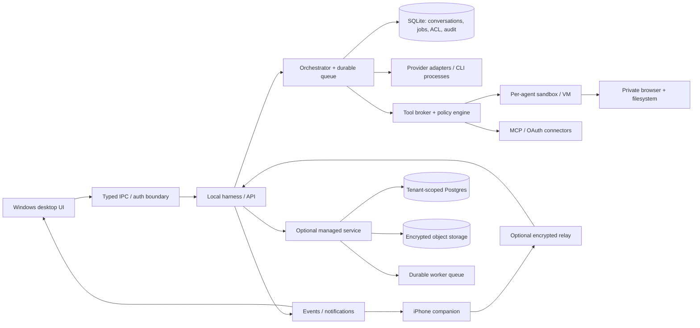

# Uitvoerbaar plan: open-source AI-agentplatform met Windows-installer en iOS-app

**Doel:** een eigen product bouwen dat de bruikbare functies van OpenBot/Grok Bot benadert: meerdere persistente AI-agenten, providers naar keuze, plugins/apps, skills, routines, live spraak en bediening vanaf iPhone. Dit document is een bouwbrief voor Claude Code. Het is geen claim dat de producten of functies al zijn gebouwd.

**Onderzoeksdatum:** 6 november 2026. Functies van referentieproducten veranderen; vóór elke release moeten de actuele documentatie, provider-API's en licenties opnieuw worden gecontroleerd.

## 1. Onderzoeksconclusies

De naam “OpenBot” verwijst publiekelijk naar meer dan één project. Dit plan gebruikt als primaire productreferentie `nightly-labs/openbot` / `openbot.run`, dat zichzelf beschrijft als een local-first werkplek voor persistente AI-teamgenoten, met desktop, plugins/marketplace en een iPhone-client. Er bestaat daarnaast onder meer `ashhart/OpenBot`, een veel kleinere, vroege macOS-only herimplementatie. Houd die projecten en hun code/licenties strikt uit elkaar.

De hoofdreferentie ondersteunt afzonderlijke agenten met eigen instructies, werkruimte en provider-sessie; agent-naar-agent-berichten en overdracht; wachtrijen; bestanden delen; ingebouwde browser; desktopkanalen; routines; modelkeuze per agent; lokale modellen en provider-CLI's; marketplace voor agents, skills en apps/plugins; mobiel chatten en bestanden sturen; en servers die lokaal, zelf gehost of beheerd kunnen draaien. De repo noemt zichzelf echter een development preview en waarschuwt dat agents momenteel ruime toegang hebben. Een nieuwe app moet daarom vanaf het begin expliciete machtigingen en grenzen ontwerpen.

De iPhone-referentie is een mobiele bediening voor agents die op desktop/server draaien. De desktop/server moet online zijn; apparaten koppelen via een eenmalige QR-code en versleutelde verbinding. Voor ons product betekent dit: geen agent-runtime op iOS in versie 1. De app toont gesprekken/voortgang, kan spraak invoeren, notificaties tonen en bestanden sturen.

De markt-/licentiegrens is belangrijk: de `nightly-labs/openbot` repository vermeldt **PolyForm Noncommercial 1.0.0**. Die licentie staat niet-commercieel gebruik toe, niet het bouwen en verkopen van een concurrerende betaalde dienst op basis van die code zonder aparte commerciële licentie. Ook de naam, logo's, screenshots, teksten, marketplace-data en providermerken niet kopiëren. Veilige route: eigen merk, eigen UX/code, publiek gedocumenteerde functionaliteit en open protocollen; laat een jurist de licentie, merken, afhankelijkheden en providervoorwaarden controleren voordat er code wordt overgenomen of verkocht.

Open source en omzet kunnen samengaan. Maak de client, server en protocol onder een permissieve licentie zoals Apache-2.0/MIT beschikbaar, met derdepartij-licenties en SBOM. Verdien aan optionele beheerde cloud, opslag/compute, teambeheer, back-ups en support. Laat gebruikers hun eigen model/API-account koppelen. Verkoop geen toegang tot ChatGPT-abonnementen en gebruik OAuth/CLI-auth alleen via ondersteunde, officiële flows.

## 2. Productdefinitie

**Werknaam:** `TeamBot` (tijdelijk; vóór publicatie merk-/domeinonderzoek en definitieve naam kiezen).

**Belofte:** “Maak je eigen AI-team. Gebruik je eigen modellen en tools. Start lokaal of gebruik een beheerde server. Open source en exporteerbaar.”

**Platformen voor eerste openbare versie:**

- Windows 11 x64 desktopprogramma (Windows 10 alleen optionele legacy-support op systemen met actuele ESU; niet als primaire security-baseline) met ondertekende installer en automatische updates.
- iPhone-app via TestFlight en daarna App Store; iOS is remote client voor een desktop- of serverhost.
- Linux server via Docker Compose voor zelfhosting; macOS kan later als desktop-host volgen.

**Open-source grens:** alle kernfunctionaliteit die nodig is om zelfstandig te draaien blijft in de open repository. Betaalde dienst biedt gemak en beheer, geen verborgen noodzakelijke functionaliteit.

## 3. Functie-inventaris en prioriteit

Deze MVP/Na-MVP tabel geeft alleen de eerste fasering weer. De volledige eindscope staat in secties 20–24; geen functie uit de uiteindelijke catalogus vervalt doordat zij hier als “Na MVP” staat.

Deze MVP/Na-MVP tabel geeft alleen de eerste fasering weer. De volledige eindscope staat in secties 20–24; geen functie uit de uiteindelijke catalogus vervalt doordat zij hier als “Na MVP” staat.

| Onderdeel | Eerste versie (MVP) | Na MVP | Acceptatie-uitkomst |
|---|---|---|---|
| Agenten | Aanmaken, naam/avatar/rol/instructies, provider/model kiezen, agent verwijderen/exporteren | Sjablonen uit marketplace, versies en dupliceren | Agent houdt eigen thread en geïsoleerde workspace; provider wisselen verliest de thread niet |
| Providers | OpenAI API, OpenAI Codex/ChatGPT via ondersteunde Codex-flow, Anthropic API/Claude Code via officiële flow, OpenAI-compatible endpoint, Ollama | Gemini, xAI/Grok, OpenCode, ACP-adapters, fallback provider | Elke adapter toont auth-status, capabilities, beperkingen en kostenbron; secrets blijven OS-vault/server-side |
| Gesprekken | Streaming chat, markdown, attachments, zoeken, contextmeter, pauzeren/stoppen, foutstatus | Reactions, deelbare rooms, export naar Markdown/JSON | Herstart of crash verliest geen geaccepteerd bericht/job |
| Werkruimtes | Per agent/project-directory, bestandslijst en veilige upload/download | Workspace-sjablonen, gedeelde map/teamprojecten | Geen stilzwijgende toegang buiten toegestane roots |
| Agent-team | Taak aan andere agent delegeren, antwoord terug naar eigenaar, eenvoudige taakstatus | Kanalen met gedeelde geschiedenis, meerdere agenten samenwerken/reviewen | Mens ziet wie wat uitvoert; taak kan stoppen, hervatten, herverdelen |
| Tools/plugins | Eerste partij: web search, browser lezen, bestand lezen/schrijven met toestemming; MCP-connector voor tools | Marketplace voor apps/connectors; OAuth-koppelingen zoals GitHub, Notion, Slack, Drive, Linear | Elke connector toont scopes; per connector ontkoppelen en credentials intrekken |
| Skills | Skills beheren/installeren/verwijderen, compatibel `SKILL.md`-formaat; eerst expliciete review | Marketplace, updates/pinning, checksum/handtekening, versiebeheer | Skill is instructie + metadata; code-uitvoerende skills krijgen aparte waarschuwing/sandbox |
| Routines | Handmatig uitvoeren en eenvoudige planning (dagelijks/wekelijks), timezone, pauzeren | Trigger op event, retries, meldingen, uitvoeringshistorie | Geen dubbele run bij restart; gebruikers zien volgende run en laatst resultaat |
| Browser/computer use | Browser via Playwright in geïsoleerde browsercontext; alleen na toestemming | Beeldscherm-/computerbediening per OS | Preview/goedkeuring voor mutaties; standaard read-only; log van actie en resultaat |
| Live spraak | Push-to-talk in desktop en iOS; transcript zichtbaar/bewerkbaar; antwoord als audio optioneel | Hands-free VAD, interruptie, voice persona, gesprekshervatten | Duidelijke mic-indicator/consent; mute/stop direct; failover naar tekst |
| iOS | QR-koppeling, chats, streaming status, push-to-talk, upload foto/document, notificaties | Widgets, Siri/App Intents, offline drafts | Werkt tegen eigen desktop/server; revoke koppeling beëindigt toegang |
| Cloud | Geen cloud nodig voor lokaal; optionele account alleen voor remote relay/licentie | Managed host, team seats, backups, admin, billing | Klant kan data exporteren/verwijderen; local mode functioneert zonder account |
| Security | First-run disclosure, tool-permission prompts, least privilege, audit trail, secret vault | Enterprise SSO/SCIM, retention policies, policy administration | Deny-by-default voor acties met impact; geen verborgen code-uitvoering |
| Release | Installer, updatekanaal, crash-safe migrations, checksums, SBOM | Microsoft Store, staged rollouts, macOS/Linux GUI | Schone installatie, update, rollback en uninstall gedocumenteerd |

### Marketplace-datamodel

- **Agent template:** instructie, beschrijving, versie, compatibele provider/capabilities, meegeleverde skills en routines. Nooit mee: conversation history, user files, credentials of private memory.
- **Skill:** `SKILL.md`, metadata, compatibiliteit, required tools, install instructions, license, checksum, publisher, version.
- **Plugin/app:** MCP server of native connector package, tool schemas, requested OAuth scopes, permissions, data-flow disclosure, setup status, support link, license.
- **Review:** automatische format/lint/security checks plus menselijke review bij hosted directory. Community/self-host directory blijft mogelijk en krijgt duidelijk “unverified” label.
- **Install flow:** preview → toon permissions/third-party calls → selecteer agent → installeer → configureer auth → test read-only → pas daarna acties toestaan.

## 4. Technische architectuur

### Desktop/server

- **Desktop shell:** Electron + TypeScript voor snelle cross-platform Windows-build; renderer React of Solid, backend in Electron main process. Alternatief Tauri pas na een aparte feasibility spike. UI kan gedeeld worden met web client.
- **Agent runtime:** aparte worker/service per agent, durable SQLite database voor lokale gebruiker; Postgres voor managed cloud. Queue/job runner met persisted state, retries/idempotency, stop token en event stream.
- **Provider abstraction:** één `ProviderAdapter` interface voor auth, model listing, stream, tool calling, context limits en cancellation. Houd providerspecifieke features expliciet zichtbaar; simuleer geen compatibiliteit.
- **Tool layer:** typed tool registry, schema-validatie, permission evaluator, per-agent capability grants, audit events. MCP aansluiten via officiële SDK/spec; credentials in OS credential store of cloud secret manager.
- **Browser:** Playwright Chromium in aparte user-data dir/container. Geen toegang tot browserprofiel van de gebruiker zonder aparte import/consent.
- **Data:** lokaal onder gebruikersprofiel; database + attachments + workspaces. Versleuteling van secrets; optionele at-rest-encryptie voor cloud. Export en delete vanaf dag één.
- **Remote:** lokale host opent uitgaande verbinding naar relay; iPhone gebruikt end-to-end geauthenticeerde sessie. Short-lived QR pairing token, device keypair, revoke en rate limits. Relay transporteert ciphertext waar haalbaar en bewaart geen chats/files.
- **Cloud:** Dockerized Linux service; tenant isolation, encrypted object storage, Postgres, queue, observability zonder promptinhoud standaard te loggen. Eigen hosted deployment per klant later.

### iOS-app

Aanbevolen: React Native/Expo voor gedeelde chat UI en snellere levering óf SwiftUI indien realtime audio/background betrouwbaar niet haalbaar blijkt. Maak eerst een 1-week spike voor WebRTC audio, QR scanning, push notifications en background limits. iOS-client voert geen shell of lokale agent scripts uit. Gebruik Apple Keychain voor device credential, microphone permission op moment van gebruik, duidelijke opname-indicator, privacybeleid en account deletion als account bestaat.

### Live spraak met ChatGPT/OpenAI

Bied twee duidelijke modi:

1. **Voice chat:** client maakt een realtime spraaksessie met OpenAI's actuele Live/Realtime API. Voor browser/iOS gebruikt OpenAI WebRTC en een kortlevend client-secret; de vaste API-key blijft op de vertrouwde backend. Gebruiker ziet model/API-kosten vooraf. Dit is OpenAI API-billing, geen automatisch inbegrepen ChatGPT Plus/Pro/Codex-verbruik.
2. **Voice controls voor bestaande agent:** speech-to-text → bestaande agentworkflow → text-to-speech of audio playback. Zo kan de agent (Codex/Claude/etc.) het werk doen terwijl een afzonderlijke voicelaag de dialoog afhandelt. Tool execution vindt alleen via onze server/desktop permission gate plaats.

MVP: push-to-talk, transcript voor verzenden kunnen corrigeren, stream audio-uitvoer, stopknop, geen permanente microfoon. Later pas VAD/hands-free en interruptie. OpenAI API-modelnamen en realtime-prijzen veranderen: implementeer modelconfiguratie via server-side allowlist en prijsplafond/waarschuwing; check de officiële docs vlak voor build en release.

## 5. Veiligheidsregels (geen optionele polish)

- Geen “danger full access” default. Begin in `ask`- of read-only modus; aparte agent/planningsmodus kan geen muterende tools uitvoeren.
- File tools beperken zich tot expliciete workspace roots; shell staat standaard uit en vraagt per opdracht of gebruikt allowlist. Denylist gaat vóór allowlist.
- Destructieve/onomkeerbare acties vragen altijd bevestiging. Een goedkeuring voor één handeling wordt geen permanente toestemming.
- Skills/plugins zijn onbetrouwbare invoer: scan dependencies, toon bron/license/permissies, pin versie en checksum. Voer executable code uit in geïsoleerde sandbox met minimale netwerk-/filesystemrechten. Prompt injection uit webpagina/attachments mag geen autorisatie overrulen.
- OAuth scopes minimaal; tokens nooit in renderer/logs/templates; revoke-knop; secrets in Windows Credential Manager / iOS Keychain / server secret manager.
- Per-agent audit trail met tool, input summary, goedkeuring, resultaat en timestamps; redacteer secrets en bied privacy-safe export.
- Rate limits, spending cap en stop-all-knop voor provider/API calls en routines.
- Backups en data-retentie-instellingen. Geen promptinhoud analytics standaard.
- Security review voor externe marketplace en penetration review vóór cloud public launch.

## 6. Cloudmodel en inkomsten

**Gratis/open source:** lokale Windows app, provider bring-your-own-key/login, beperkte lokale agents, skills import/install, community connectors, exports, self-host Docker server.

**Cloud Starter (later):** always-on hosted worker, kleine opslag/compute-limiet, remote relay, eenvoudige backups. Klant betaalt infra + marge; provider modelkosten rechtstreeks via eigen credentials of aparte transparante credits.

**Cloud Pro/Team:** meerdere gebruikers, gedeelde agents/workspaces, rollen, admin logs, managed OAuth connectors, retention controls, support. Richtprijs niet vastleggen vóór hosting- en providerkosten, btw, App Store fees en doelgroepinterviews zijn doorgerekend.

**Enterprise:** dedicated tenant/VPC of self-host install, SSO, audit export, SLA, policy controls, DPA.

- Hou softwarelicentie en hosted servicevoorwaarden gescheiden en helder.
- Als open source centraal staat, kies een permissieve OSI-licentie voor eigen code (Apache-2.0 is een goede standaard voor patentgrant; laat juridisch toetsen). Geen “open-core” truc waarbij het product zonder betaalde server niet bruikbaar is.
- Cloud verkoopt compute, uptime, beheer en support; gebruikers houden provideraccounts en kunnen data exporteren.
- iOS-app moet App Store-regels volgen voor accounts, privacy, AI-datadeling en betaalde digitale functies. Laat abonnementskeuze juridisch/App Store-review toetsen voordat billing wordt ingebouwd.

## 7. Bouwfasen en beslismomenten

De onderstaande doorlooptijd is een grove planning voor een klein ervaren team, niet een toezegging. Claude Code kan de code bouwen, maar kan geen Apple/Microsoft accounts, certificaten, juridische goedkeuring of hardware-review namens ons regelen.

### Fase 0 — Repo en productcontract (1–2 weken)

- Maak nieuwe repository en naam/branding; kies licentie; schrijf threat model, data map, architecture ADRs en UX flows.
- Leg providerregels vast: officiële SDK/CLI/API alleen, geen abonnement/login omzeilen.
- Proofs-of-concept: OpenAI streaming, één CLI-provider, SQLite job persistence, Windows packaging, iOS WebRTC/QR.
- **Gate:** werkende chat op Windows; agentdata blijft lokaal; provider cost/auth disclosure klopt.

### Fase 1 — Windows desktop foundation (3–5 weken)

- Onboarding, provider setup, chat, agent create/edit, workspace, streaming, cancel/queue, persisted SQLite.
- Windows Credential Manager, settings, import/export, logs redacted.
- Bouw signed installer pipeline (EXE/MSIX keuze, update manifest, hashes, SBOM, GitHub release artifacts).
- **Gate:** schone Windows 11 x64 installatie en apart gedocumenteerde legacy-test op Windows 10 ESU, upgrade, uninstall, provider disconnect, database migration gecontroleerd.

### Fase 2 — Skills, plugins en agent collaboration (3–5 weken)

- Skill manager/importer met `SKILL.md`, marketplace protocol en signed manifest.
- MCP registry/connect flow, OAuth scopes, connector lifecycle, credential revoke.
- Agent-to-agent delegation, work queue, handoff status, notifications.
- Basic routine scheduler with pause/run history; ensure duplicate-safe jobs.
- **Gate:** untrusted skill cannot run arbitrary code; tool action visible; per-tool approval exercised.

### Fase 3 — iOS companion (4–7 weken, deels parallel)

- Pair with desktop/server via expiring QR; device management/revoke; chat/history/streaming/status; upload; push-to-talk; push notifications.
- Store privacy disclosures, permissions, privacy policy, account deletion path if accounts exist, TestFlight QA.
- **Gate:** pairing from clean install; revoked device cannot reconnect; recording consent/indicator; app review readiness.

### Fase 4 — Cloud/self-host (3–6 weeks)

- Docker self-host, remote relay and auth, managed cloud beta, billing/plan enforcement, tenant boundaries, backups, deletion/export.
- Cost dashboards and quota controls. Separate provider API costs from subscription charge.
- **Gate:** threat model + external security review; recovery/backup restore; abuse and rate-limit tests; billing cancellation.

### Fase 5 — Public release and marketplace growth (ongoing)

- Windows signed stable release; iOS App Store release; public docs, contribution guide, license notices and SBOM.
- Marketplace submissions, provenance, version pinning, takedown/reporting, community moderation.
- User feedback cadence, crash/error fixes, provider adapter updates.

## 8. Oorspronkelijke Fase 0-opdracht (verouderd; vervangen door sectie 22)

Eerste tranche (niet de volledige opdracht): begin in een nieuwe projectrepository met Fase 0. Inspecteer eerst de bestaande workspace en rapporteer welke files/projectstructuur bestaan. Maak daarna de repo-skeleton en onderstaande deliverables. Ga na deze tranche direct verder volgens de volledige uitvoering in sectie 22; wacht niet op een review om aan Fase 1 en volgende fasen te beginnen. Gebruik geen code of assets uit `nightly-labs/openbot` of andere referentieprojecten; maak een schone implementatie op basis van openbare productbeschrijvingen en officiële API/protocol-documentatie. Kopieer geen namen, branding, UI-copy, marketplace-records of screenshots.

**Fase 0 deliverables:**

1. `README.md` met productdoel, platformen, lokaal/cloud onderscheid en status.
2. `LICENSE` met Apache-2.0 (of markeer expliciet als open juridisch besluit indien repository-eigenaar nog niet heeft gekozen).
3. `docs/PRODUCT_SPEC.md` met MVP, non-goals en acceptatiecriteria.
4. `docs/ARCHITECTURE.md` met desktop/server/mobile diagram, data flow en trust boundaries.
5. `docs/THREAT_MODEL.md` met prompt injection, malicious skills/plugins, token theft, workspace escape, relay compromise en mitigaties.
6. `docs/PROVIDER_POLICY.md` met ondersteunde auth-route per provider, BYOK, geen ChatGPT subscription resale, live voice API billing.
7. `docs/IOS_WINDOWS_RELEASE.md` met Apple Developer/TestFlight/App Store en Windows code signing/MSIX/EXE stappen; houd account-/certificaatgeheimen buiten repo.
8. `docs/CLAUDE_BACKLOG.md` met de fasen hierboven vertaald naar kleine, reviewbare issues, afhankelijkheden en definition of done.
9. Een minimaal compilable shell (Windows desktop + gedeelde UI scaffold) alleen als de repo leeg is en toolchain aanwezig is; geen placeholder-claim van werkende agents.

Eindig na deze eerste tranche met: gewijzigde bestanden, gekozen technische aannames, wat nog ontbreekt, exacte lokale commands om het skelet te starten, en drie grootste risico's. Ga daarna door met de volgende uitvoeringsfase volgens sectie 22. Vraag geen credentials; markeer externe accounts/certificaten als handmatige release prerequisites.

## 9. Baseline-acceptatie voor de eerste werkende tranche (niet de volledige eindrelease)

- Nieuwe gebruiker kan de Windows-installer downloaden, verifiëren, installeren en een agent met eigen OpenAI/API provider verbinden.
- Agent kan een gesprek streamen, een taak stoppen, na app-herstart hervatten en bestanden alleen binnen de gekozen workspace gebruiken.
- Een MCP-plugin en skill kunnen worden bekeken, permissies/licentie gecontroleerd, geïnstalleerd en verwijderd; secrets zijn revoke-baar.
- iPhone kan met een tijdelijke QR pairing aan de gebruiker-host koppelen, chats volgen, push-to-talk gebruiken en een bestand sturen.
- Gebruiker kan cloudfeatures overslaan en desktop lokaal gebruiken; managed cloud opt-in en prijs/AI-providerkosten helder.
- Alle releases publiceren checksum, SBOM, license notices en changelog. Crash logs bevatten geen prompt/secret standaard.
- Geen enkele externe code actie voert uit zonder passende consent/permission; gebruiker heeft stop-all en data export/delete.

## 10. Bronnen (primaire documentatie)

- OpenBot hoofdrepo, functies en previewbeperkingen: https://github.com/nightly-labs/openbot
- OpenBot licentie (PolyForm Noncommercial 1.0.0): https://github.com/nightly-labs/openbot/blob/main/LICENSE
- OpenBot marketplace: https://openbot.run/marketplace
- OpenBot marketplace installatie/skills/plugins: https://openbot.run/guides/openbot-marketplace
- OpenBot Windows install: https://openbot.run/download/windows
- OpenBot iPhone client/pairing: https://openbot.run/download/ios
- OpenBot self-hosted server: https://github.com/nightly-labs/openbot/blob/main/docs/self-hosted-server.md
- OpenAI audio & voice docs: https://developers.openai.com/api/docs/guides/audio
- OpenAI realtime conversations: https://developers.openai.com/api/docs/guides/realtime-conversations
- OpenAI WebRTC connection: https://developers.openai.com/api/docs/guides/voice-webrtc
- Apple App Review Guidelines (privacy, recording, downloaded code): https://developer.apple.com/app-store/review/guidelines/
- Microsoft Windows distribution paths: https://learn.microsoft.com/en-us/windows/apps/package-and-deploy/choose-distribution-path
- Microsoft Windows code signing: https://learn.microsoft.com/en-us/windows/apps/package-and-deploy/code-signing-options

### Belangrijke interpretatie

“Alle functies” is geen eindige vaste scope; de referentie verandert en derdepartijproviders/marketplaces kunnen wijzigen. Dit plan definieert een functionele parity-roadmap en releasegates, geen belofte dat alles tegelijk of door één Claude-run af is. Claude Code kan zelfstandig repo-werk uitvoeren zodra projectmap en gewenste code-stack gekozen zijn; publicatie vereist menselijke accounts, signing secrets, provider accounts, kostenbesluit en App Store/Store review.

## 11. Onderzoek: hoe de referenties zijn opgebouwd

Dit is een product-/repository-inspectie van publiek beschikbare README's, documentatie en licenties. Het is geen volledige code- of security-audit. Versies veranderen; herhaal dit onderzoek bij start bouw en vóór grote releases.

### OpenBot (`nightly-labs/openbot` / openbot.run)

- **Productvorm:** Electron-desktopapp, local-first. Provider-CLI's/API's voeden persistente agents met eigen gesprekken en werkruimtes; queues, files, embedded browser, agent-naar-agent berichten en gedeelde kanalen.
- **Runtime:** desktop voor Windows/macOS/Linux; aparte Linux self-hosted server/Docker voor always-on. iPhone is companion. Provider-CLI kan managed of bestaand op systeem zijn.
- **Extensies:** marketplace voor agents, skills en apps/plugins; MCP-connectors. Agent-template kopieert setup, niet gesprekken/bestanden.
- **Computers:** execution targets variëren per platform; VM/container/host computer-use en approvals. Workspace-folder is niet hetzelfde als sandbox.
- **Aandacht:** project meldt development preview en brede agentmachtigingen. Hoofdrepository gebruikt PolyForm Noncommercial 1.0.0 met aparte commerciële licentie. Niet als commerciële codebasis gebruiken zonder schriftelijke toestemming.

### MausBot / OpenMausBot (`milind-soni/OpenMausBot`)

- **Productvorm:** Electron + TypeScript/Vite desktop met ingebouwde harness service op loopback die agentprocessen beheert; ook server/headless modus.
- **Botmodel:** elke bot krijgt engine/model, persona, thread-memory, werkmap, apps, computer en automatiseringen. Rooms/teams, delegatie en MCP-orchestratie.
- **Engines/integraties:** CLI's zoals Claude/Codex/Grok, API-providerkeys en lokale modellen; MCP/Composio/native tools. Per provider auth/billingvoorwaarden respecteren.
- **Computers:** host computer waar platformgrenzen zijn goedgekeurd, lokale geïsoleerde VM, cloud Linux desktop en eigen VPS/remote host. Preview/control. Scheid computer-sandbox van werkmap.
- **Mobiel/remote:** iOS companion naar desktop/server via pairing/relay; actuele release controleren welke functies GA zijn.
- **Build/release:** repo noemt Node/pnpm/Electron, embedded harness, Windows setup.exe, macOS DMG en Ubuntu-pakketten. Releases bevatten checksums/notices/SBOM voor onderdelen zoals CUA driver.
- **Licentie:** kernrepo Apache-2.0; `enterprise/` heeft eigen voorwaarden; vendored CUA driver en dependencies behouden licenties. Mogelijke kandidaat voor onderdelenhergebruik na commit-, folder-, dependency- en notice-audit. Geen merk/branding kopiëren.

### Bloks (`hamedgitty/bloks` / bloks.dev)

- **Productvorm:** messaging UI; bots zijn contacten, rooms groepsgesprekken; iPhone/Watch companion.
- **Team:** lead/room model, sequentiële leden, @handoff, expliciet akkoord voor hires; per agent interrupt/queue/automatic; meerdere terminaltabs.
- **Memory:** Markdown MEMORY/topicbestanden/shared memory/About You; capped brief, reviewbare persoonlijke suggesties, diffjournal en undo.
- **Tools/computers:** OAuth connector cards, MCP, eigen browser, cloud Linux VM, lokale VM, host desktop of headless sandbox; rehearsal op kopie, diff/undo, desktop preview rewind.
- **Automation/voice:** routines, one-shot tasks, folder/web/feed watchers, webhooks met dedupe/run cap; voice calls; lokale Mac meetingtranscriptie met expliciete toestemming. Sommige onderdelen beta/platformgebonden.
- **Licentie:** repo/site beschrijft commerciële restrictie en release wordt volgens hun voorwaarden pas na twee jaar MIT. Behandel huidige code als niet voor commerciële afleiding, tenzij exacte releasevoorwaarden na juridisch advies anders zeggen.

### MausBot-naam

Bronnen gebruiken MausBot/OpenMausBot. Controleer canonical repo, tag, package license en actuele docs; naam alleen bewijst niets.

## 12. Hergebruik van bestaande software

**Ja, we moeten niet alles zelf schrijven.** Hergebruik protocollen, SDK's, libraries, connectors en skills waar techniek én licentie het toestaan. Geen blind repository-kopie.

1. Eerst officiële SDK/protocollen: MCP, ACP waar passend, provider-SDK's, Playwright, SQLite/Postgres, WebRTC/mobile libraries.
2. Daarna onderhouden kleine libraries met door legal goedgekeurde permissieve licenties (MIT/Apache/BSD/ISC); controleer transitive deps, fonts, icons, native binaries en notices.
3. GPL/AGPL/LGPL, source-available of dual-license vereist aparte architectuur- en legal review. Geen ongemerkte dependency.
4. OpenMausBot Apache-2.0 core is een kandidaat, maar audit gekozen commit, uitsluiting `enterprise/`, CUA driver, third-party runtime en alle deps. Bloks/OpenBot behandelen we als productonderzoek tenzij exacte versie commercieel hergebruik expliciet toelaat.
5. Geen merknamen, logo's, screenshots, productcopy, private marketplace-data of proprietary skillteksten kopiëren. Permissief gelicentieerde skills mogen geïmporteerd worden met attribution; inspecteer op secrets/malware/injection.
6. CI moet SPDX licenses, lockfile, SBOM (CycloneDX/SPDX), license allowlist, notices, build provenance en signed releases afdwingen.
7. Houd reuse manifest bij: URL, commit, file/package, license, wijzigingen, attribution, bundled status, commerciële status. Legal sign-off vóór main/installer.

### Stack hypotheses (beslissen met korte spikes)

| Onderdeel | Startkandidaat | Selectiecriteria |
|---|---|---|
| Desktop | Electron/TypeScript | Native access, sandboxing, installer, update, team skills |
| Agent service | Lokale loopback harness + adapter interface | Streaming, crash recovery, ACLs, provider breadth |
| Integraties | MCP + curated OAuth/native; Composio optioneel na voorwaarden/pricing | Scopes, data residency, self-host, connectorkwaliteit |
| Browser/computer | Playwright isolated context; CUA driver apart beoordelen | Isolation, approvals, Windows dekking |
| Storage | SQLite lokaal + Markdown/files; Postgres cloud | Export, migrations, full-text, job durability |
| iOS | Eerst SwiftUI spike | Realtime audio, background/push, accessibility, ship velocity |
| Scheduler | Durable timezone-aware job queue | Missed jobs, retries, dedupe, cloud wake |

Geen van deze technologieën is vastgezet voordat prototypes en licentiechecks zijn afgerond.

## 13. Geheugen en dossiers: functionele + technische uitwerking

### Regels

- Archiveer gesprekken volgens ingestelde retentie, maar laad nooit het hele archief in elke prompt.
- Houd actieve memory compact; ieder item heeft bron, datum, confidence, scope, sensitivity, validiteit/expiry en status.
- Geheugen is geen modeltraining en geen oncontroleerbare blob: CRUD, audit, versie, export, undo en delete propagation.
- Agenten stellen memory voor; gebruiker keurt gevoelige/persoonlijke informatie goed. “Vergeet” is harde blokkade tegen opnieuw opslaan.
- Antwoorden tonen bronverwijzingen naar bericht/dossier/bestand. Zonder bron: onzekerheid aangeven.
- Delete verwijdert/tombstonet item én afgeleide samenvattingen, embeddings, caches, dossierkopieën en indexen; tombstone blijft gelden bij backup-restore tot retentie afloopt.

### Typen/scopes

1. Turn context: alleen actieve taak.
2. Thread episode: compacte taak/conversatiesamenvatting, besluiten, acties, artefacten, status met links naar oorspronkelijke berichten.
3. Agent profile: identiteit, instructies, model, tools; user-controlled.
4. Agent memory: rol-/projectgebonden feiten/voorkeuren; privé per bot als standaard.
5. About-you: user-owned voorkeuren; agent suggesties eerst in review queue; nooit automatisch met team delen.
6. Project/client dossier: entiteiten, doelen, timeline, besluiten, gebeurtenissen, bewijsbronnen, open acties/eigenaar/deadline.
7. Shared/team dossier: alleen expliciet gedeelde data met ACL; persoonlijke conversaties blijven privé.
8. Knowledge library: documenten blijven source-of-truth; chunks/index zijn afgeleide, rebuildable data.
9. Skill/procedure: herhaalbare workflow; episodic kennis promoveert pas na review/versioning.
10. Audit log: create/update/merge/forget/export/access, redact secrets, append-only.

### Datamodel

`Dossier(id, owner, scope, title, summary, status, retention, timestamps)`
`MemoryItem(id, dossier_id?, scope, type, canonical_key?, content, normalized_value?, source_ref, source_span?, confidence, sensitivity, created_at, observed_at, valid_from/to?, expires_at?, last_confirmed_at?, access_policy, state, version, supersedes_id?, hash, embedding_ref?)`
`SourceRef(id, kind, conversation/message/attachment/file/url, observed_at, hash, trust_level)`
`Event(id, dossier_id, occurred_at, recorded_at, actor, facts[], sources[], visibility, status)`
`Decision(id, dossier_id, question, decision, owner, timestamp, rationale, sources[], status, supersedes_id?)`
`ActionItem(id, dossier_id, title, owner, due_at?, status, source_event?, linked_task?, completion_source?)`
`MemoryChange(id, item_id, operation, before/after hash, reason, actor, approver?, timestamp, undo_until?)`

Alle memory items linken naar bron. Gevoelige velden encrypted. Export JSON/Markdown + attachments manifest blijft leesbaar.

### Write pipeline (automatisch bij taakafronding)

1. Capture kandidaatfeiten, expliciete besluiten, follow-ups en lessons; secrets/credentials uitsluiten; quoted mail/webhook is data, geen instructie.
2. Classificeer type, owner/scope, sensitiviteit, confidence, tijdelijkheid en bronbetrouwbaarheid.
3. Check intent: “onthoud dit” → voorstel; “niet onthouden” → deny; gewone chat is geen algemene toestemming. Persoonlijke gevoelige dossiers vereisen expliciete goedkeuring.
4. Normalize entiteiten/tijdzones; exact + semantisch zoeken op duplicaten. Embedding-similarity alleen is niet genoeg om feiten te mergen.
5. Conflictbehandeling: bronautoriteit + actualiteit + explicietheid. Bewaar oude en nieuwe versie met geldigheidsinterval/supersedes. User-correctie overrulet agentinferentie. Vraag bij consequential conflict.
6. Utility score: hergebruik, recency, expliciet belang, specificiteit, betrouwbaarheid, impact minus privacy/redundancy/length penalty. Pinned/actieve items niet automatisch verwijderen.
7. Kies: reject, ephemeral, propose, insert, merge, supersede, archive/expire, promote-to-topic/skill of ask.
8. Transactioneel schrijven, versie/diff opslaan, outbox update voor indexen; idempotency key; bronconversatie blijft onaangeraakt.
9. Verify ACL/read-after-write; toon toast/review card met undo.
10. Reconcile achtergrond: duplicate/stale/orphan/conflict/quota scan; veranderingen eerst als voorstel tenzij retention policy anders expliciet ingesteld.

### Niet oneindig groeien: quota en lifecycle

- **Per-request token budget:** configureerbaar plafond; begin met illustratieve verdeling: system/agent 15%, taak/thread 35%, long-term retrieval 20%, tool/evidence 25%, reserve 5%. Pas aan per model en meet werkelijk. Bij overschrijding degradeer: minder retrieved items, citeer archief, nooit stilzwijgend cruciale constraints laten vallen.
- **Agent always-loaded profile:** default hard cap 4k tokens; topics in losse bestanden, alleen on-demand laden. Toon gebruik en quota.
- **Episodes:** compacte samenvatting, niet transcript dupliceren. Raw conversatie blijft archive searchable. Dedup per bron/taak.
- **Dossier/storage quota:** limiet records/bytes per scope; attachments apart; closed dossiers archiveren; usage dashboard.
- **Consolidatie:** na N nieuwe items of schema; merge equivalenten, distill herhaalde patronen, behoud bewijs en diff, rollback. “Samenvatten” is anders dan “vergeten”.
- **TTL/review date:** tijdelijke taakstate korte TTL; veranderlijke feiten reviewdatum; pinned geen expiry tenzij user kiest. Soft-delete/prullenbak (bv 30 dagen) tenzij verzoek om privacy-delete vraagt.
- **Retrieval:** hybride lexical + vector, metadata/date/entity filters; ACL-filter vóór vector search; top-k onder tokenbudget; brondiversiteit; dedup/rerank; citeer ieder item.
- **Compaction:** trigger vóór contextlimiet. Bewaar commitments, constraints, besluiten, open vragen, tooluitkomsten en source IDs. Repetitie/kleine praat uit actieve context; origineel blijft terugvindbaar. Summary versioning/restore.
- **Forget propagation:** alle derived stores en embeddings updaten; tombstone moet backup restore en reindex overleven; deletion receipt meldt klaar en eventuele backup-expiry.
- **Runaway guard:** background jobs hebben token/cost/time cap, één job per scope, pause switch, geen automatische promotie van agent-to-agent claims zonder provenance.

### Dossier-UX en acceptatie

Sidebar **Memory & dossiers** met Overview, About you, Agents, Projects, Shared, Review queue, History/Undo, Storage. Dossier toont samenvatting, timeline, besluiten, acties, personen/organisaties, bronnen/bestanden, toegangsrechten, laatste update en audit. Search filtert scope/date/type/source/status. Gebruiker kan edit/pin/forget/export/delete, pauze auto-learn, quota zien.

- “Wat weet je over project X?” toont source/date/confidence cards.
- Conflicten verschijnen als reviewkaart, nooit stille overwrite.
- Geheugenwijziging heeft diff + bron + undo.
- Eval: recall, selective forgetting, update/conflict, chronology, provenance, ACL isolation, multi-agent attribution, summary fidelity, poisoned webhook rejection, quota behavior.
- Metrics: grounded-answer rate, stale-memory error rate, duplicate rate, forgotten-data residual retrieval, prompt tokens, undo/rejection rate.
- Doel is correcte bruikbare recall én betrouwbaar vergeten; niet maximaal onthouden. Onderzoek benoemt forgetting/update als aparte kwaliteitsproblemen.

## 14. Bot-computers: privé versus gedeeld

Een **workspace** is filescope; een **computer** is runtime scope. UI mag folder niet als sandbox presenteren.

### Modes per agent

1. Chat only, geen tools.
2. Selected folder, geen shell/screen.
3. Private headless container: shell/files/browser, network allowlist, resource quota, persistent bot volume; runtime te rebuilden zonder data te verliezen.
4. Private local VM met GUI/browser, eigen disk, snapshot/restore, pause/resume. Windows onderzoekt Hyper-V/WSL2 en fallback; Hyper-V is niet beschikbaar op Home-edities en vereist geschikte hardware/virtualisatie. Daarom moet de installer runtime-capabilities detecteren en op niet-geschikte systemen de fallback als minder geïsoleerd labelen of cloud VM aanbieden. Windows 10 Home/Pro bereikte end-of-support op 14 oktober 2025; primaire release-support moet Windows 11 zijn, en Windows 10 mag alleen als expliciete legacy-configuratie met geldige ESU/LTSC-beperkingen worden getest. Geen “VM isolation” claim als slechts process permissions zijn gebruikt.
5. Private cloud computer: per-bot Linux VM, encrypted persistent disk, kostenmeter, idle sleep/wake, live preview en action approval.
6. Shared team computer: expliciete gedeelde VM/workspace; roomleden met ACL. Eén controller tegelijk via lease/mutex; anderen wachten of lezen snapshot. Browser profiel alleen expliciet delen.
7. My desktop: per-app/window opt-in; read-only standaard; preview + bevestiging voor click/type/submit/delete. Host profile nooit zonder named-site consent; room kan host access niet escaleren.

### UI, isolatie en samenwerking

Bot settings → **Computer & files** toont mode, runtime status, host, workspace, persistent data, allowed domains/apps, quota, cloudkosten en wat verwijderen doet. New bot wizard legt de keuzes in simpele taal uit en kiest least privilege. Live panel toont screen preview, activity timeline, stop/pause, take-control, reset/restore, computer info en huidige controller.

Disk scheidt base image, private writable disk, shared volume, downloads en cache. Quota cleanup vraagt preview en verwijdert nooit user files stilzwijgend. Resource failure stopt browser/tool eerst, behoudt workspace, verklaart wat gepauzeerd is; nooit fallback naar host.

Shared room setup vraagt expliciet: computer owner, gedeelde files?, browser profile?, lead-only of lease, approvers. Iedere agent krijgt permissions: observe, read files, scratch write, shared write, browser, host control, package install, admin. Child agents erven maximaal ouderrechten. Private memory/conversation wordt nooit automatisch shared.

Workers werken in eigen clone/branch/scratch disk; lead keurt merge/apply naar shared workspace goed. Non-code writes gebruiken version check + conflict UI. External side effects (email send, publish, purchase, merge, delete) vragen human approval ongeacht mode. Lease eindigt pas als control process echt gestopt is, niet alleen door timer.

## 15. Design/layoutspecificatie

### Windows desktop shell

Drie verstelbare zones:

- **Left rail 240–280 px:** workspace picker, New, search (`Ctrl+K`), projects, agents (avatar/status/unread/approval), rooms, routines, marketplace, memory/dossiers, settings. Collapsible tot icon rail met labels/tooltips.
- **Chat center min 480 px:** header met agent, engine/model, computer mode, context/memory indicator, menu; message stream met datumdividers en tool/task cards; composer vast onderin met attachment, push-to-talk, text, send/stop en mode. Queue boven composer.
- **Right inspector 320–400 px:** Activity, Files, Memory, Computer, Details tabs; tool calls samengevat en uitbreidbaar naar exacte input/output; approvals met scope/risk/one-time approve/deny; diff/review/undo; computer preview en control owner.
- Bij venster <1100 px wordt inspector drawer; <760 px sidebar overlay. Stop-knop moet altijd vindbaar blijven.
- Approval verschijnt inline plus notificatie; notificatie keurt nooit automatisch goed.

### iPhone companion

- Bottom tabs: Chats, Team, Activity, Memory, Settings; inbox badge voor approval/vraag.
- Chats lijst met status online/working/needs-you/paused; thread composer met hold-to-talk, slide-to-cancel, file/photo, keyboard; run zichtbaar stoppen.
- Approval sheet toont actie, target, gegevens, gevolgen, scopes; approve once/deny; Face ID ontgrendelt app maar keurt andere actie niet stil goed.
- Computer preview portrait; landscape fullscreen; indicator controller + pause/take control. Tekstbediening blijft bestaan bij videofout.
- Memory toont quick capture, About you, project cards, review queue, dossier timeline.
- Mic alleen na expliciete tap/permission; zichtbare recording state; transcript edit vóór send; audio stop/interrupt. Geen permanent luisteren.
- Offline host duidelijk tonen; drafts/queue markeren als nog niet afgeleverd.

### Visuele regels en componenten

Semantische tokens voor canvas/surface/text/muted/border/accent/success/warning/danger/focus; light/dark/high contrast. Proza 65–85 tekens breed, monospace alleen code. Spacing 4/8/12/16/24/32. Min touch target 44pt iOS, toetsenbordfocus Windows, tekstschaal 100–200%, reduced motion. Iedere component heeft default/hover/focus/pressed/disabled/loading/empty/error/offline/permission denied. Kleur niet als enige statusdrager. WCAG 2.2 AA target; VoiceOver/Windows screen reader; labels voor author/time/status/tool/approval. Nederlands en Engels initieel; lokale datums/timezones; externe strings; RTL-ready.

Iedere pagina heeft empty/loading/error/offline/permission state, herstelstap en link “waar staat mijn data?”. Geen nep-progress/typing states. Geen icon-only functionaliteit zonder label.

### Journeys (wireframes + acceptatie)

1. Install → privacy/permission → provider → eerste bot → nuttige taak binnen 3 min.
2. Skill/plugin → author/version/license/scopes/data destination → target agent → connect → read-only test → revoke/uninstall.
3. “Onthoud dit” → source/scope voorstel → edit/approve/decline → toekomstige cited retrieval → undo/forget.
4. Eigen computer → isolation/cost/quota → run → activity → diff → apply/undo.
5. Shared room/computer → ACL/lease → delegate → observe → approve side effect → audit timeline.
6. iPhone pair → one-time QR → progress/approval → revoke → toegang stopt direct.

## 16. Hoe we aantoonbaar beter worden

Geen ongefundeerde claim “beter dan X”. Vertaal naar meetbare doelen en publiceer tests.

| Doel | Ontwerpverbetering | Bewijs vóór claim |
|---|---|---|
| Minder ingewikkeld | Setup wizard met provider uitleg en first task <3 min | 10 nieuwe-gebruiker sessies, completion/time/errors |
| Betrouwbaarder geheugen | Cited dossiers, bounded memory, conflict update, undo/forget | recall + stale fact + deletion residual + ACL evals |
| Veiliger computer access | echte per-mode isolation, approvals, leases, rollback | threat model, sandbox tests, externe security review |
| Betere teams | lead/worker board, queues, attribution, concurrency control | multi-agent task success, duplicate rate, completion time |
| Veiliger extensions | provenance, license/dependency scan, grants, sandbox | malicious skill/plugin test suite, revoke audit |
| Betere voice | PTT first, transcript editing, interruptions, visible consent | P50/P95 latency, noisy-device success, cost/minute |
| Sterkere Windows delivery | ondertekend installer, update/rollback, clean uninstall | Windows 11 support matrix; optionele Windows 10 ESU legacy matrix en SmartScreen first-run UX |
| Heldere kosten/privacy | split model/compute/hosting/seats; local mode no account | billing reconciliation, network inspection, user comprehension |

## 17. Bronnen

- OpenBot repo/license: https://github.com/nightly-labs/openbot · https://github.com/nightly-labs/openbot/blob/main/LICENSE
- OpenBot marketplace/Windows/iOS/self-host: https://openbot.run/guides/openbot-marketplace · https://openbot.run/download/windows · https://openbot.run/download/ios · https://github.com/nightly-labs/openbot/blob/main/docs/self-hosted-server.md
- OpenMausBot repo/docs/automation: https://github.com/milind-soni/OpenMausBot · https://docs.openmausbot.com/docs · https://docs.openmausbot.com/docs/features/automation
- Bloks repo/docs: https://github.com/hamedgitty/bloks · https://bloks.dev/docs/
- OpenAI voice docs: https://developers.openai.com/api/docs/guides/audio · https://developers.openai.com/api/docs/guides/realtime-conversations
- Apple review rules: https://developer.apple.com/app-store/review/guidelines/
- Microsoft distribution: https://learn.microsoft.com/en-us/windows/apps/package-and-deploy/choose-distribution-path
- LangGraph state/memory source design: https://docs.langchain.com/oss/javascript/langgraph/thinking-in-langgraph
- MemoryAgentBench: https://arxiv.org/abs/2507.05257
- Memora (consolidation/update/forgetting): https://arxiv.org/abs/2604.20006
- MemCut (residual recovery after forget): https://arxiv.org/abs/2610.21405

## 18. Claude Code research task (before writing implementation)

First run a **read-only research/reuse audit**, no code copied and no files modified except its report. Report must contain:

1. Feature matrix for OpenBot, OpenMausBot/MausBot, Bloks and Grok Bot. Mark shipped/beta/planned/platform-limited/paid; link source and check date.
2. Repo architecture map: desktop, harness, provider adapters, data, memory, plugins, skill install, computer runtime, mobile, cloud, build/sign/release.
3. Folder/package/commit license report for candidate reuse, transitive deps and bundled runtime; check Apache enterprise exclusion and Bloks/OpenBot restrictions.
4. Build-vs-reuse decision per component with license obligations and security risks.
5. Proposed architecture and trust/data-flow diagrams for private computer, shared computer, local Windows, iOS companion and cloud.
6. Memory/dossier schema, read/write/consolidate/delete flows, quotas, failure cases and evaluation plan.
7. Windows/iPhone screen map and six end-to-end user journey wireframes with acceptance criteria.
8. Open questions/risks; no user credentials requested.

Only after report review, implement small vertical slices: (1) desktop + provider + durable chat; (2) memory/dossier + citation/update/delete evals; (3) isolated computer + snapshots/undo; (4) skills/MCP permissions; (5) teams/shared computer; (6) iOS pairing + voice; (7) self-host/cloud billing. Build installer and TestFlight build are later release outputs, not the output of one research prompt.

## 19. Eerder plan bijwerken

Deze toegevoegde secties verfijnen de eerdere hoge-level regels over memory, computers, UI en faseplanning. De Claude eerste opdracht in sectie 8 blijft beperkt tot Fase 0, maar gebruik nu de uitgebreidere research deliverables uit sectie 18. Live voice gebruikt OpenAI API/Realtime (aparte API-metering), niet automatisch een ChatGPT-abonnement. De Windows-app kan lokaal werken; iOS verbindt met desktop/server; always-on jobs vereisen host/server die draait of een managed worker.

# MASTER FUNCTIECATALOGUS — vergelijking van publiek gedocumenteerde functionaliteit

**Dit hoofdstuk is leidend voor scope.** Het eerdere document was te hoog-over en de research-only opdracht wordt vervangen door de uitvoeropdracht in hoofdstuk 22. Dit is een inventaris van publiek gedocumenteerde productfuncties per 6 november 2026; gesloten backend-implementaties en niet-openbare algoritmen zijn niet te inspecteren. Voor elke cel geldt shipped/beta/platform-limitation zoals de bron op die datum aangeeft.

## 20. Producten, bouwmodel en unieke functies

### A. Grok Bot (Cursor/xAI product)

- Cloud SaaS en desktop/mobile clients; bots draaien op een persistent cloud computer, dus werk gaat door als laptop/app uitstaat. Desktop/local execution is een aparte opt-in.
- Bot aanmaken via natuurlijke taal; naam, rol/context, computer, connected apps; keuze van model is automatisch (geen bot model picker volgens FAQ).
- Per account gedeelde computer: files, browser sessions, logins, CLI credentials delen botten. Elk bot heeft eigen screen/work surface voor parallel desktop control, maar dit is geen security boundary.
- Conversatie: berichten, dictation, voice chat, reply/mention, attachments, images/files/links, inline tool activity, approvals/forms, voice memos, live status, follow-up terwijl bot werkt.
- Team: bots in parallel; direct bot-to-bot messages; groups with shared context, delegation/ownership transfer; each retains own memory, but group outputs visible to all; teams/admins can invite users and set policies.
- Skills/routines: save skill from successful task or teach-by-demonstration (review draft); routines on schedules or events (Slack, GitHub, Linear, Sentry, PagerDuty, email, webhook); test, pause, edit, run history, quotas/rate limits; X @bot handoff; Slack integrations.
- Connected tools: app plugins/connectors, MCP where available, browser fallback; Vault/password manager/Secure Forms for login; human takeover for SSO/passkey/CAPTCHA/QR/payment verification; sensitive actions can have approval and Auto Review layer.
- Memory: stable preferences, important facts, role context and dated work summary; bot-specific plus a few shared user facts; autonomous write (no approval by default), conversational inspect/correct/forget, no full memory screen on personal bot; memory is not truth; deletion of bot/account clears memory. Files/browser/handoffs transfer context. Strongly note shared-computer cross-bot exposure.
- Admin/security: team usage/policies, identity, private network, logging/audit, Auto Review; deployment controls; app and iOS/Android; possible X and Slack access.

### B. OpenBot, hoofdrepo `nightly-labs/openbot` / openbot.run

- Local-first desktop Electron app + optional hosted/self-hosted server; agent execution can use local provider CLIs or custom endpoints; iPhone is paired companion, not independent agent runtime.
- Persistent agents: separate identity/instructions/workspace/conversation/provider session; switch provider without losing identity/thread; creation/editing; own folders/files.
- Providers: Codex, Claude, Grok CLI, OpenCode, Pi, Gemini, Cursor, Cline, Kimi, Devin, GitHub Copilot, Hermes via ACP, custom ACP, OpenAI-compatible APIs, Ollama/LM Studio (exact support moves with releases).
- Tasks: queue/cancel/pause/resume; background task inbox and desktop notifications; context usage/compaction; agent-to-agent delegation/files; channels/shared conversation; routines and handoffs.
- Tools: file/shell/fetch/web search/browser/computer use; approvals/modes; routines record/replay; browser persistent context; LAN rooms that intentionally omit files/tools/reasoning/secrets.
- MCP/connectors: settings catalogue for GitHub, Slack, Google Drive, Notion, Linear + arbitrary stdio/remote servers; labelled accounts; OS credential store.
- Marketplace: Agents, Apps/Plugins, Skills; preview metadata, install to selected bot; review submissions; template excludes user conversations, memory/model settings/workspace files. Skill is task instructions; plugin connects service; credentials local and source scopes apply.
- iOS: pairing/mobile connect, chat/status/file upload/approvals. Current product marketed iOS App Store; feature details must be verified by release. Host/server must be on for local computer mode.
- Deploy: local desktop; Linux self-hosted server and Docker; cloud managed team option. Code license is PolyForm Noncommercial—commercial reuse needs separate license.
- Limit caveat: main repo README describes current release as development preview in relevant sections; check actual tagged build/security model and avoid assuming every page/feature is stable.

### C. OpenBOT early implementation `ashhart/OpenBot` (separate from nightly-labs)

- MIT licensed Electron/macOS early project, drives local CLIs and APIs; plain JSON local data.
- CLI adapters `opencode`, `claude`, `codex`, `pi`, `droid`; direct Anthropic/OpenAI/OpenRouter/xAI APIs. Multi-bot collaboration in a chat, named groups/broadcast tasks, independent `delegate_task`, projects/kanban.
- Skills discovered from standard CLI directories, install/uninstall safely under `~/.agents/skills`; built-in file/shell/web/search/todo/per-bot memory/computer tools.
- Modes agent/ask/plan; approvals ask-every-time, ask-first-time, allowlist, auto-run with deny-first; per-bot workspaces, VM/Chrome/external VM; routines, inbox, background work. Mac-specific computer use and managed VM architecture.
- This is not the nightly-labs OpenBot app and is not evidence for the same feature set. Its MIT licensing may allow specific code reuse, but audit repo version/dependencies/assets and maintain notices.

### D. OpenMausBot / MausBot (`milind-soni/OpenMausBot`)

- Local-first Electron/TypeScript desktop, loopback harness owns agent processes; personal data/config/conversations remain local unless user configures cloud/remote.
- Bot profile has identity, memory, skills, tools, connected apps, computer preference. Multiple independent threads per bot with own provider session, approvals, cost/running state; folders are organization only, not ACL or sandbox; thread history search/edit/branch/rewind/pin/react/export/share; attachments, image context, tokens/cost, search.
- Providers via native CLI/ACP and direct API adapters. UI shows install/login states and model catalog; unavailable engines visible; multiple account configs (where supported); API provider connection without filesystem access distinct from CLI agent.
- Groups/rooms: multiple bots share one transcript; each keeps own provider session/model/permissions; shared broadcast message can address multiple bots; turn-taking, lead/Chief of Staff/department, `@` messages, pause/resume one bot, auto/everyone, delegated specialist jobs as separate threads, explicit statuses/failure/cancel, token/cost per group; team shared agents/private conversations and inbox routing.
- Safety: structured approval cards/questions, inspector, per-action tool events; app says no blanket app-level approval beyond configured access levels in some paths, so our design must ensure consistent unified broker. Human takeover for login, credentials filled without bot seeing secret; local control explicit opt-in; platform boundaries fail closed.
- Computer options: no computer, host, local containerized VM desktop, remote/cloud computer, own VPS via hardened container/SSH; live preview/takeover. Browser profiles/account contexts; desktop and shell actions; persistence and contention guards.
- Connected apps: Composio Session marketplace (hundreds), multiple labelled accounts, MCP servers, native integrations, secrets stored write-only locally. App auth is per user/provider; data scopes visible.
- Skills: selected/approved per bot; workflows and shared templates; skills should be inspectable and permission-bound. Routines: one-time/repeating/weekdays, schedules with timezone, webhook triggers, startup catch-up, run receipts/statuses, history, quiet when no update, independent execution context, optional previous-run memory, rate limits and retry on provider quota. Watchers/event triggers possible per docs/release.
- Voice: spoken replies via remote/local TTS, dictated composer, half-duplex call mode, newer Live mode via OpenAI/Azure with interrupt; captions and call record; voice notes with transcript; iOS/Android voice capability varies.
- Mobile: iOS native thin client pairs via high-entropy expiring QR or code; LAN/Tailscale/optional HTTPS relay; list bots/rooms, paged chat, interrupt, approve/questions, search, task management, react, share, message versions and optional cloud screen view; phone cannot reach provider keys/admin/VM lifecycle/webhook secret routes; revocation invalidates device. Host must be awake for local execution.
- Deployment: desktop release, self-host VPS/Docker, optional managed cloud. App-specific enterprise folder is under separate terms; core Apache-2.0 plus third-party notices/SBOM.

### E. Bloks (`hamedgitty/bloks`)

- Local-first desktop and iPhone/Apple Watch; personal/business workspaces, each with independent bots, rooms, memory, keys and switcher; team membership, roles, limits and invitation verification.
- Bot as contact with role, editable persona, first-question onboarding, own engine/model, up to parallel conversation lanes, statuses, queue/interrupt/automatic steering, replies/forwards/reactions, live tool summaries, cost/usage, backup engine on provider outage, prompt-driven role templates and engine recommendation/scout.
- Rooms/group chat: lead and rotating members, @target, sequential contributions/replies, shared context, handoffs, team hiring requires approval; shared/team agents, departments/Chief of Staff, user-specific inbox, message attribution, access per person/room, guests only see invited room.
- Skills/apps: app connector cards (Composio), OAuth cards mid-task then resume, MCP server integration (Bloks itself can expose restricted MCP), agent-specific app enablement, secret cards. Skills are Markdown files with templates/roles; publish/share team skills and sync revisions; secrets excluded from conversations.
- Automations: routines, one-off scheduled tasks, folder/web/RSS watchers, condition filters, triggers, approved check commands, dedupe/no repeat notifications, quotas; webhooks and cloud email. Schedules only run while Bloks open on local machine; cloud relay reach does not make local machine always-on.
- Computers: local VM, cloud desktop, host desktop, headless sandbox; own browser profile; screen preview/rewind, desktop panel + chat, human takeover. Rehearsals execute against folder copy with file-by-file diff and apply/discard, compare agents, conflict check, undo; rewind conversation and corresponding file changes while preserving user's intervening edits.
- Memory: own MEMORY.md always loaded + topic files; shared memory/About You; caps to briefing; editable, journal with diff/undo; user preferences suggestions require approval; retrieval of own past chat only; no broad transcript in every prompt.
- Voice: per-agent TTS; live/turn voice and group calls where addressed by name; meeting notes local on macOS with consent/screen-record permission; voice marked beta per docs. Companion call behavior/platform requires version check.
- Data: readable plain JSON/Markdown under local folder, no account for local mode. Optional cloud relay is end-to-end sealed in product claims; business cloud plans. Source license commercially restricted for recent versions, later MIT release per terms; audit exact release.

### F. Common market patterns and gaps

- **Shared computer design** (Grok) makes handoff simple but bots are not isolated from each other's files/logins. **Private computers** (OpenBot/MausBot/Bloks) improve separation but complicate shared collaboration/resources.
- **Simple chat-first bot creation** is compelling; **advanced per-bot setup** is needed for access safety and predictable outputs. Offer beginner wizard and advanced settings without hiding rights.
- **Memory tradeoff:** Grok auto-learns and is easy but memory is not fully browsable; Bloks makes memory readable/capped/undoable; OpenMausBot has visible/editable memory and history recall. Combine visible memory, source citations, automatic proposals, limits, user controls, conflict handling and comprehensive deletion.
- **Scheduling tradeoff:** cloud always-on vs local privacy/offline cost. Support both, with honest “host must be awake” status; cloud worker is separately opt-in.
- **Provider flexibility tradeoff:** integrated model can be seamless (Grok), BYO CLI/API/local improves choice and cost-control. Support adapters with transparent per-engine capabilities and fallback only on provider unavailability, never hide a change of model.
- **Best-of-market additions:** signed install/updates; first-class shared team + private bot sandboxes; readable audit; reversible changes; true memory lifecycle; compatibility with common skill/MCP/ACP; cross-platform voice; operation without account; cloud only when user chooses.

## 21. Complete target scope: elke productfunctie op één backlog

Claude moet iedere regel hieronder opnemen als epics/issues met dependency, owner, platform, risk, acceptance checks en status. Label `P0` release foundation, `P1` first public parity, `P2` advanced/enterprise. “Compleet” betekent alle P0-, P1- én P2-functies zijn geïmplementeerd, geïntegreerd en geverifieerd vóór de volledige productrelease. P0/P1/P2 bepalen bouwvolgorde en afhankelijkheden, niet of een functie uit de eindapp mag ontbreken. Geen roadmap-only kernfunctie, geen UI-knop zonder werkende backend en geen verborgen placeholder.

### 21.1 Identity, bot creation en management

- **P0:** eerste-run setup; engine scan/install/connect; template/new bot wizard; prompt-to-bot profile (name/avatar/color/role/goal); review generated instructions before save; model, reasoning, access profile, workspace and computer; default profiles for future bots; provider status/model list; clone/duplicate; pin/hide/archive/delete; restore archived; bot sort/search; export/import profile; bot icon/status/unread/approval count.
- **P1:** role library, team templates, bot version history, scheduled hire proposal, usage/cost/quota display, fallback engine, explicit cross-provider session migration, profile changes with diff/undo.
- **Acceptance:** no silent fallback to different provider/model; failed creation leaves no partial bot; delete explains what conversations/memory/files/routines are deleted and what survives.

### 21.2 Chat, threads and content

- **P0:** streaming text/markdown/code/tables; tool progress; task state; cancel/pause/resume; busy message policy (queue/interrupt/auto per bot); retries; per-thread provider session and approvals; independent parallel threads; attachments/images/files; links/link preview; message reply/forward/edit/delete/reactions/pin/copy; searchable persistent history; export; message timestamps; empty/loading/error/offline states; token/context/cost meter; context compaction; local notifications.
- **P1:** branch/rewind with file changes, user edits protected; structured forms/cards/widgets, HTML preview sandbox; transcript versions; sync across devices; inbox for approvals/questions/reports; desktop badge and mobile push; drafts while host offline.
- **Acceptance:** crash-safe queue and transcript; no duplicate side-effect on retry; thread deletion/rewind semantics documented; generated HTML cannot run privileged APIs.

### 21.3 Group chats, teams and orchestration

- **P0:** create/rename/archive group; choose bots; group instructions; shared transcript; `@bot`, `@all`, reply and explicit targeted requests; sequential round-robin or lead mode; one bot broadcasts to chosen bots in parallel with separate tracked runs; each member has its own model/permissions/memory; task owner/lead; delegate bounded subtask to bot outside group without adding it as visible member; handoff and result/status; stop/resume one bot or whole group; per-member timeout and failure; approval/question routed to correct human; group cost ledger; attribution of author/source; loop/cycle/handoff cap; group search/export; private chat never leaked to room.
- **P1:** departments/teams, chief of staff and role hierarchy; team people/roles, invite/revoke, guests restricted to room; per-agent and per-room ACL; team inbox/notification routing; shared bot versus personal bot distinction; room shared files and shared computer; lead can suggest new member but human approves; meeting/voice group; shared board/kanban and artifact review.
- **P2:** team admin, SSO/SCIM, policy caps, audit export, quotas/cost allocation, team templates/marketplace.
- **Acceptance:** group run state machine per participant; one bot cannot answer another bot's approval; no circular autonomous delegation; maximum tool/model turns and spend cap; user can identify what each bot saw and changed.

### 21.4 Providers, agents and model choice

- **P0:** provider interface; OpenAI API; official Codex App Server/CLI flow where permitted; Anthropic API/Claude Code flow where permitted; OpenAI-compatible custom endpoint; Ollama/LM Studio; custom ACP runner; model capability descriptors (tools, vision, voice, context, streaming, auth type, cost source); secure credential store; install/auth state; per-bot/per-thread model; custom base URL; timeout/cancel/retry; model availability explanation.
- **P1:** Grok/xAI API/CLI, Gemini, OpenCode, Cursor, Cline, Pi, Kimi, Copilot, Hermes, Devin/other ACP adapters only after official support/licensing; provider-specific reasoning options; backup engine on explicit provider outage/rate limit; usage estimate and budget caps; optional API key onboarding.
- **P2:** provider fleet/admin, model routing policy, org key vault, team usage allocation.
- **Acceptance:** no provider subscription resale or login circumvention; CLI plan terms surfaced; model switch preserves visible transcript but identifies switch; no automatic account rotation; test connect without surprise billable prompt.

### 21.5 Memory, dossiers, knowledge and learning

Use full design in section 13, plus:
- **P0:** profiles, conversation archive, episode summaries with citations, user/agent/project scopes, reviewable memory suggestions, per-agent/shared memory, read/edit/pin/forget/undo, source citations, storage/token quotas, stale/conflict queue, dedup, export/delete across derived stores, memory search, user-controlled auto-learn toggle.
- **P1:** structured dossier objects (people, companies, events, decisions, actions, owners, dates, sources); timeline/relations; document ingestion/indexing with ACL; topic files; memory import from another assistant; automatic entity resolution and consolidation; backups/restore with tombstone protection.
- **Acceptance:** exact provenance and ACL, bounded prompt budget, stale fact conflict behavior, hard forget test, shared/private isolation, evaluate retrieval and selective forgetting separately.

### 21.6 Skills, plugins/apps, connectors and marketplace

- **P0:** skill import (`SKILL.md` + YAML metadata); inspect/edit/version/delete; source/license/author/dependencies/platform requirements; per-agent enablement; prompt-only skills separated from executable plugins; tool permission manifest; MCP stdio/remote transport; OAuth credential flow; connection health/test/revoke; connector-specific scopes; secret card; native first-party web/search/files tools; extension inventory/update.
- **P1:** marketplace tabs for agents/skills/apps; filter/search/categories; detail/version/change log/permission/price/license display; install preview; skill staged atomic install; checksums/signatures; curated verified/unverified labels; report/takedown; version pin/rollback; submit review; template strips memory, secrets, chats and workspace; connectors (GitHub, Slack, Drive, Notion, Linear, Gmail, Calendar) prioritized by user interviews; optional Composio integration if terms/data flow work.
- **P2:** developer SDK, connector packaging, signed publisher identity, compatibility checks, organization allowlist.
- **Acceptance:** install cannot execute arbitrary code without extra trust consent; third-party prompt text treated as untrusted; update cannot elevate permissions silently; uninstall removes only managed paths; log shows every permission use.

### 21.7 Computers, files, browser and computer use

Use full modes in section 14, plus:
- **P0:** workspace roots and safe file read/write/patch/list; shell disabled until explicitly configured; private container/VM spike; persistent per-bot disk; browser profile per bot or shared by explicit grant; computer selection per bot; live screen preview; stop/takeover; login handoff; action log; resource caps; snapshot/rehearsal and file diffs; download/upload approvals; external-domain/network policy.
- **P1:** Windows local host computer support; per-bot private GUI VM; shared room computer leases; parallel independent screens; safe installers/package management for bot VM; headless sandbox; cloud VM and own VPS backend; route egress via home desktop opt-in; VM image update/rollback; screen history rewind; rehearsal compare multiple agents.
- **P2:** managed pool/scaling, dedicated tenant hardware, GPU/local model computer.
- **Acceptance:** workspace is not described as sandbox; no fallback host; missing capability fails closed; host control app allowlist; screenshots may redact secrets; login values never enter chat/model; mutable operations preview/approve; resource exhaustion preserves data.

### 21.8 Automations, routines, watchers and triggers

- **P0:** one-time, interval, weekday/cron schedule with timezone; routine uses explicit bot, model, tools, computer, permissions; pause/resume/edit/delete; Test run; run receipts/history; missed-run policy; quiet no-update path; retry/cancel; idempotency; cost/rate caps; notification/approval routing.
- **P1:** event triggers from webhook, email, Slack, GitHub, Linear, Sentry, RSS/feed, folder/page watcher; payload quoted as untrusted data; narrow filters; dedupe; trigger history; secret rotation; startup catch-up; last-run context option under limit; routine results own thread; manual run; background jobs survive UI close via always-on server.
- **Acceptance:** schedule DST/timezone correct; user sees whether local host must stay awake; rate limits; duplicate trigger cannot duplicate external side effect; routines pause if provider entitlement ends; human approval for send/purchase/delete/publish/prod.

### 21.9 Voice, calls, dictation and meeting notes

- **P0:** push-to-talk/dictation on Windows/iOS; transcript preview/edit; text-to-speech per bot; controls mute/stop; recording indicator; voice attachments with transcript/captions; voice provider configuration; API cost disclosure; fallback text; assistant identity disclosure.
- **P1:** OpenAI Live/Realtime WebRTC, interruption/VAD, connect existing task agent backend, group voice turn-taking/mention by name, call history/action record, per-bot voice, local TTS option; meeting note capture with explicit system permissions/consent and no-retention option.
- **Acceptance:** API key server-side/ephemeral, never ship secret in mobile app; mic never on by default/background; latency/cost metrics; end call immediate; transcript retention control; explicit who receives audio.

### 21.10 Mobile companion and remote access

- **P0:** iPhone native app; expiring one-time QR/device pairing; Keychain per-device credentials; bot/room list, paged history, live updates, send messages, attachments, task status, stop, questions/approvals, search, notifications, revoke. Desktop/server is execution owner.
- **P1:** computer viewer/takeover; iOS voice; device switching; multiple workspaces; offline draft; deep links; widgets/Siri shortcuts; watch approval actions only with clear action details.
- **P2:** Android, tablet/iPad optimized.
- **Acceptance:** default deny mobile API routes; phone cannot fetch API keys/admin/secrets; revocation immediate; LAN/Tailscale/relay encrypted; host offline shows honest state.

### 21.11 Cloud, team SaaS, billing and operations

- **P0:** local mode no account; Docker self-host; optional encrypted relay; config/data export, delete, backup/restore; service health, version/update; error reporting opt-in and redacted.
- **P1:** managed always-on cloud agents; tenant isolation; Postgres/object store/queue/secrets; regional deployment; billing and subscription lifecycle; quotas; metered provider costs separated from hosting; DPA/retention; support portal; status page.
- **P2:** dedicated/VPC, SSO/SCIM, admin audit, policy management, BYO cloud keys, SLA.
- **Acceptance:** local product remains functional without subscription; exact billing statements; cancellation stops future compute and preserves export window; lifecycle cleanup/revoke; incident response and backups tested.

### 21.12 Design, accessibility, localization and polish

- Windows shell and iOS layouts in section 15; theme, contrast, scaling, keyboard shortcuts; onboarding; global search; empty/error/loading states; typography; mobile safe areas; accessibility; Dutch/English; localization of time/currency; purposeful notifications; activity and audit views.
- **Acceptance:** usability studies, WCAG 2.2 AA audit, VoiceOver and Windows screen-reader checks, 100/150/200% scaling, keyboard-only flow, low-width breakpoints.

### 21.13 Build, security, release and maintenance

- **P0:** repo hygiene, CI, static analysis, dependency/license allowlist, SBOM, secret scanning, threat model, migrations, backup, crash recovery, native signing plan; unit/integration/e2e checks for high-risk flows; installer artifacts and checksum.
- **P1:** signed Windows installer (Store/MSIX and/or signed EXE), auto-update with staged rollout/rollback, iOS TestFlight/App Store, public docs, release provenance/attestation, security policy, vulnerability response, localization and crash reporting controls.
- **P2:** macOS/Linux installers, enterprise deployment, support/SLA.
- **Acceptance:** clean install/upgrade/uninstall matrix, code-signing key custody, reproducible build where possible, licenses/notices included, no private keys in repo/build artifacts.

## 22. One Claude master execution instruction

The Claude prompt should ask Claude to operate as **technical lead and implementation agent for the whole product**, not only prepare a research report. At the repository root, Claude must first inspect workspace and existing code; then create `docs/MASTER_PLAN.md` from sections 1–21, feature matrix, architecture, trust boundaries, UX maps, data model, dependency/reuse manifest, and dependency graph. It must preserve scope and turn each P0/P1/P2 line into a traceable issue/task with testable acceptance criteria and `docs/STATUS.md`.

After writing the spec, Claude should immediately implement the project in vertical slices, keeping the app runnable at each checkpoint and updating `STATUS.md` and `CHANGELOG.md`. It should not stop after the planning report and should not ask us to approve routine technical choices. It should make reversibly safe assumptions and record them in ADRs. Stop only for truly external prerequisites (Apple developer account, Windows signing identity, payment account, paid API key, domain, production credentials) and list the exact manual action, while continuing independent implementation. Never expose or request secrets in repository files. Do not publish, purchase services, or use customer data without explicit authorization.

### Required execution order

1. **Research and reuse audit:** reproduce the current reference comparison using linked official docs and repo/tag sources; note date/status/platform/paid/beta. Audit candidate package dependencies by exact license and version. No copy/paste from restricted code. Pick reusable projects with written license manifest, SBOM, notices, attribution and exclusions. Decide technical stack with a short prototype and record ADR.
2. **Design foundation:** produce app shell wireframes and component/state inventory for Windows, iPhone, memory/dossier, group chat, approval, marketplace, bot computer, shared computer and onboarding. Define design tokens and accessible variants. Build a clickable prototype.
3. **Secure desktop core:** architecture skeleton with recorded ADRs; Windows desktop app + local harness; provider adapter; one direct API and one CLI; agent creation, threads, stream, queue/cancel, local SQLite, export; secret store; no broad shell permissions.
4. **Memory/dossier:** schema, candidate pipeline, profile caps, episodic summaries, provenance, ACL, conflict review, merge/dedupe, quota/compaction, history/undo/delete and benchmark harness; deliver a readable dossier UI.
5. **Skills/plugins:** skill registry/installer, MCP host/client, OAuth connector framework, permissions preview, secrets cards, extension scanning/signatures, marketplace UI and review pipeline.
6. **Computer runtimes:** isolated per-bot container/VM; private browser and profile; snapshots/rehearsal/undo; take-over; permissions; resource limits; windows computer-use spike and fail-closed fallback.
7. **Group chat/teams:** room modes, parallel broadcast, lead/turn taking, reply/mentions, bounded delegate, handoff/task board, pause/resume, per-bot contexts, room ACLs, shared computer leases, cost ledger and human approval routing.
8. **Automations:** schedule, timezone/DST, event triggers, webhook, watchers, idempotency, dedupe, missed runs, run receipts/history, spend limits, cloud/local operation clarity.
9. **iOS companion/voice:** QR pairing, Keychain, mobile API allowlist, push/approvals/chat/file transfer, OpenAI Live/Realtime API with secure session token, dictate/TTS, optional screen viewing; TestFlight build.
10. **Self-host/cloud:** Docker deploy, relay, always-on worker, team memberships, tenant isolation, retention/export/delete, subscriptions/credits and billing controls. Cloud optional; BYO provider costs split out.
11. **Release:** Windows signed installer/store route, iOS App Store readiness, migration/security/localization/accessibility/performance review, SBOM/license bundle and signed release notes.

### Claude definitions of done

- Each feature has backend behavior, UI states, permission model, persisted state, error behavior, documentation and automated acceptance checks.
- Each phase builds and launches on available local target. Keep a running app and installer artifacts as soon as feasible; do not wait until the final phase to package. Continue through every P0, P1 and P2 item; phases are sequencing only. Do not declare product complete while any catalog feature is merely planned, mocked, hidden or marked “later”.
- Current phase, blockers, manual prerequisites, files changed and how to continue are recorded in `docs/STATUS.md` at every milestone.
- Report test commands/results; never claim tests pass unless run. Add tests for implementation despite Codex's own test default; Claude master brief explicitly requires tests because this is high-risk multi-platform software.
- A feature not yet implemented is labeled “not implemented”; no fake controls, mock success or marketing claims. Final completion requires every catalog feature implemented or a documented legal/platform impossibility with a working alternative and explicit owner decision; do not silently remove scope.

## 23. Research limits and source trail

All publicly documented features can be mapped; private infrastructure internals, source code for closed Grok Bot, hidden prompts/algorithms, actual unreleased features and private contracts cannot be discovered from the internet. Treat those as unknown; design from observable behavior and first-party docs. Recheck links at implementation time because projects ship frequently.

Additional primary sources:
- Grok Bot overview: https://docs.x.ai/grok-bot/overview
- Grok Bot official feature matrix/docs: https://docs.x.ai/grok-bot/bots · https://docs.x.ai/grok-bot/chat-and-collaboration · https://docs.x.ai/grok-bot/skills-routines-and-automations
- Grok Bot computers/apps: https://docs.x.ai/grok-bot/computer-and-apps
- Grok Bot security/Auto Review: https://docs.x.ai/grok-bot/security · https://docs.x.ai/grok-bot/approvals-security-and-privacy
- Grok Bot teams/mobile: https://docs.x.ai/grok-bot/shared-bots · https://docs.x.ai/grok-bot/mobile
- OpenMausBot feature map: https://docs.openmausbot.com/docs/features
- OpenMausBot bots/threads/groups: https://docs.openmausbot.com/docs/features/bots-and-tasks · https://docs.openmausbot.com/docs/features/chat-and-teams
- OpenMausBot provider/computer/automation/mobile/voice: https://docs.openmausbot.com/docs/providers · https://docs.openmausbot.com/docs/computers · https://docs.openmausbot.com/docs/features/automation · https://docs.openmausbot.com/docs/mobile/ios-companion · https://docs.openmausbot.com/docs/features/voice-and-memory
- Bloks workspaces, team, approvals, memory, computers, skills, voice: https://bloks.dev/docs/
- OpenBot main repo: https://github.com/nightly-labs/openbot
- Early separate OpenBOT repo: https://github.com/ashhart/OpenBot

## 24. Einddoel verduidelijkt

De doeluitkomst na uitvoering van dit plan is een complete, releaseklare Windows-app plus iOS companion, met de volledige afgesproken functiecatalogus (P0, P1 en P2), een open-source kern, optionele cloud, alle providers/extensies die rechtmatig en technisch ondersteund kunnen worden, uitgebreide groepschat, geheugen/dossiers, eigen en gedeelde botcomputers, voice en gecontroleerde beveiliging. De bouwvolgorde mag gefaseerd zijn; de uiteindelijke release mag geen afgesproken functie ongebouwd laten. Claude moet voortgang en openstaande punten blijven bijwerken en mag de opdracht pas als voltooid rapporteren wanneer alle acceptatiecriteria zijn gehaald. Een claim dat de app objectief beter is dan concurrenten mag pas na vergelijkende gebruiks-, betrouwbaarheids-, veiligheids- en prestatiemetingen; dat verandert niet het ambitieuze productdoel om hun gedocumenteerde functies te evenaren en daar aantoonbare verbeteringen bovenop te leveren.

## 25. Reviewcontrole en verduidelijkingen

Bij deze laatste controle zijn de volgende punten expliciet gemaakt:

- **Één leidende uitvoerinstructie:** sectie 22 en de einddoelcriteria in 21/24 zijn leidend. De oudere Fase 0-opdracht in sectie 8 is alleen historisch/voorbeeld en geeft Claude geen reden om te stoppen na planning.
- **Complete suite versus oneindige connectorlijst:** de app moet alle beschreven productcapaciteiten leveren en de gangbare open ecosystemen ondersteunen. Dat betekent een extensie-architectuur die compatibele `SKILL.md`-varianten, MCP, ACP, OpenAI-compatible endpoints en optionele connectorproviders kan gebruiken. Het betekent niet dat we elke bestaande private connector/marketplace-listing eigenhandig moeten kopiëren. Elke connector krijgt een compatibiliteitsstatus, licentie, bron, benodigde scopes en teststatus. Voeg een connector toe via bestaande onderhouden SDK/registry als de voorwaarden dit toelaten; anders documenteer de adapterinterface en prioriteer op gebruik.
- **“Beter” is een release-eis én een meetclaim:** productdoel is feature parity met de publiek beschreven functies plus verbeteringen in geheugenbeheer, isolatie, herstel/undo, installatie, transparantie en cost control. Claude bouwt de verbeteringen; vergelijkende tests met dezelfde taken, apparaten en providerlimieten moeten de superioriteitsclaim onderbouwen.
- **Open-source hergebruik is geen kopieerrecht op elk product:** hergebruik libraries, protocollen, provider SDK's, MCP/ACP tooling, permissief gelicentieerde skills en Apache-2.0 delen na exacte commit/dependency audit. Geen proprietary branding/copy/assets; geen noncommercial/source-available code in commerciële build zonder schriftelijke licentie.
- **Platformgrenzen expliciet:** iOS is companion; lokale agents vereisen desktop/server. Always-on execution vereist always-on host of opt-in managed worker. Windows host computer-use, VM isolation, mobile background audio, Store signing and App Store approval need concrete build/device validation, not documentation-only claims.
- **Provider terms expliciet:** user-owned ChatGPT/Claude/provider subscriptions are not resold or proxied unless the provider explicitly permits the integration. API billing, CLI login and included plan entitlements are separate paths; UI must state which path is active.
- **Release completeness:** all items in the function catalog must be either shipped and verified or flagged as an external prerequisite that blocks the release. “Later”, “planned”, “beta mock” and “not available on this platform” cannot be represented as complete parity.

### Final verification checklist Claude must attach to release report

1. Feature-by-feature matrix references requirement ID, platform, implementation link, status and evidence.
2. Windows 11 x64 clean-install/upgrade/uninstall/update/signature matrix; Windows 10 alleen als expliciete ESU legacy-test and iOS device/TestFlight/App Store readiness matrix.
3. Group chat tests: parallel fan-out, lead handoff, private/shared visibility, per-bot memory/model/permissions, approval routing, stop/resume, duplicate/cycle prevention, expense limits.
4. Memory tests: stale facts, contradictions, citations, ACL leakage, consolidation quota, explicit forget cascade, restore after backup, sensitive data exclusion.
5. Extensions tests: install/update/rollback/uninstall, malicious skill prompt injection, dependency/license notice, credentials/scopes, revocation.
6. Computer tests: private and shared runtimes, contention, lease expiry, host fallback blocked, takeover, snapshots/rehearsal, crash/resource exhaustion, persistent data.
7. Voice tests: Windows/iOS microphone consent, mute/interrupt/end-call, transcript retention, API secret isolation, model/provider outage, usage cost.
8. Routine tests: timezone/DST, missed schedules, retries/idempotency, webhook auth/rotation, dedupe, host asleep, cancellation and spend cap.
9. Security/privacy review: threat model addressed, release SBOM and notices, data flow/retention/export/delete, secrets scan, external review before cloud production.
10. Comparative evidence: task set and build versions for at least onboarding, group coordination, memory updates/forgetting, skill install, computer safety, voice task and interruption recovery; publish metrics and known limitations.

## 26. Infrastructuur- en platformcontrole (reviewaanvulling)

### End-to-end request flow

Keep the local harness bound to loopback and require authenticated, origin-checked IPC. Do not expose the desktop management API publicly; relay only the minimal mobile routes. Separate control plane (accounts, pairing, billing, device metadata) from data plane (prompts, files, provider tokens, workspaces). If relay must route plaintext audio/video, document that exact boundary and retention; default architecture should keep payload end-to-end encrypted where functionality permits.

### Windows support finding

As of this research date, Windows 10 Home/Pro passed end-of-support on 14 October 2025; Microsoft says ESU/LTSC have separate conditions. The main security support target should therefore be a current supported Windows 11 x64 release. Windows 10 can be an explicitly bounded legacy configuration only where the device has applicable ESU/LTSC support; do not describe unsupported Windows 10 as the recommended secure configuration. Hyper-V cannot be installed on Home editions and needs hardware virtualization/SLAT, so the product must capability-detect and state the actual isolation level. Source: [Microsoft Windows 10 lifecycle](https://learn.microsoft.com/en-us/lifecycle/products/windows-10-home-and-pro), [Hyper-V installation requirements](https://learn.microsoft.com/en-us/windows-server/virtualization/hyper-v/get-started/Install-Hyper-V).

### iOS release requirements

App Store SDK requirements move over time. At this research date, Apple requires App Store uploads built with Xcode 26 or later using an iOS 26 SDK since April 28, 2026. Claude should check Apple's current App Store Connect requirements at release time, pin the Xcode/SDK version in CI and produce an archive/TestFlight build on macOS. Source: [Apple upcoming App Store requirements](https://developer.apple.com/news/upcoming-requirements/?id=02212025a).

### Platform fallback truth table

| Capability | Windows 11 Home | Windows 11 Pro/Enterprise | iOS | Linux self-host | Cloud worker |
|---|---|---|---|---|---|
| Chat/provider CLI | Yes, with normal OS permissions | Yes | Companion only | Yes | Yes |
| Folder workspace | Yes, restricted by broker; not VM isolation | Yes | No local agent filesystem | Yes | Tenant-scoped volume |
| Private local VM | Capability-dependent; do not assume Hyper-V | Hyper-V/WSL2 capability check, suitable runtime | No | Container/VM capability check | Dedicated/isolated runtime tier |
| Host computer use | Separate opt-in, support only after driver validation | Same | Takeover/view only | X11/runtime-specific, fail closed otherwise | Not applicable to user's host |
| Always-on routines | Only while app/host is awake | Only while app/host is awake | No | While service is running | Yes, billed quota |
| iPhone remote access | Host awake + secure pairing/relay | Host awake + secure pairing/relay | Client | Host/service awake | Cloud always-on |

The UI must explain this table through per-feature status and the computer setup wizard; never show a button that silently degrades from VM to host access.

### Verification notes from this review

- Reconciled legacy Fase 0 stop instruction with the full Claude build instruction; section 22 now governs and section 8 is explicitly marked superseded.
- Clarified that the function catalog is the final scope; MVP/“after MVP” labels only describe ordering.
- Clarified what “all integrations” means: compatible connector/plugin architecture plus supported high-use connectors, with license/status display—not an impossible promise to duplicate every proprietary marketplace entry.
- Corrected Windows security baseline based on Microsoft's lifecycle and Hyper-V edition requirements; added current iOS SDK release gate.

### iOS build environment prerequisite

The iOS app source can be authored in the repository from Windows, but compiling, signing, archiving, and uploading a native iOS app requires macOS with Xcode. Claude must prepare and maintain the iOS project and CI workflow, then use either an available Mac or an authorized hosted macOS runner. If neither exists, continue implementation and run all platform-independent checks, but mark the signed IPA/TestFlight upload as blocked by the missing build environment; do not claim an iOS release artifact exists. Apple Developer signing credentials stay in the secure CI secret store and are never committed.
